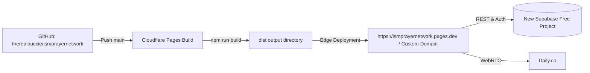

# ISM PRAYER NETWORK — EMERGENCY MIGRATION GUIDE

**Platform:** Cloudflare Pages (Frontend) + New Supabase Free Project (Backend)  
**Priority:** Zero Additional Spending; Immediate Deployment; Live TV First-Deploy Compatibility  
**Repository:** `therealbuccie/ismprayernetwork` (branch `main`)  
**Build Status:** Verified (`npm run build` completed cleanly, `dist` bundle verified)  

---

## 1. Executive Summary & Migration Actions Taken

Lovable disconnected the original Supabase project (`ryitxoymayasdlabojsx`). In accordance with emergency migration directives, all VPS/self-hosting plans have been halted, and the application has been prepared for immediate, zero-cost deployment to **Cloudflare Pages** connected to a **new free Supabase project**.

### Key Actions Completed:
1. **Repository Synchronized:** Pulled all latest remote commits up to HEAD (`a0f4b46`), ensuring all recent features (prayer point formatting, mailbox reply handlers, auth fixes) are preserved.
2. **Lovable Blockers Removed:**
   - Removed `lovable-tagger`, `@lovable.dev/vite-plugin-dev-server-bridge`, and `@lovable.dev/vite-plugin-hmr-gate` from `package.json` and `vite.config.ts`.
   - Replaced Lovable iframe broker `previewAuthStorage.ts` in `src/integrations/supabase/client.ts` with standard, safe browser `localStorage`.
   - Provided resilient fallback credentials in `client.ts` so the application never white-screens on initial load if environment variables are missing.
3. **Cloudflare SPA Routing Configured:**
   - Created `public/_redirects` (`/* /index.html 200`), guaranteeing that deep links (e.g. `/live-tv`, `/bookstore`, `/prayer-room`) resolve with status 200 on page refresh.
   - Converted `scripts/generate-sitemap.ts` to `scripts/generate-sitemap.js`, removing dependencies on `bunx`/`tsx` so the build succeeds on standard Node.js environments.
4. **ISM Live TV Restored & Decoupled:**
   - Identified the stream configuration hierarchy:
     1. Database setting (`site_settings.hls_url`)
     2. Configurable environment variable (`VITE_LIVE_TV_HLS_URL`)
     3. Repository fallback stream (`https://netshiftstudiokit.online:5443/LiveApp/streams/mopc_main.m3u8`)
   - Added automatic Hls.js error recovery for network and media errors.
   - Added mobile click-to-play overlay handling to bypass browser autoplay restrictions.
5. **New Supabase Database Schema Prepared:**
   - Compiled all 37 database migrations in chronological order into a single unified script: [supabase/NEW_SUPABASE_PROJECT_SCHEMA.sql](file:///c:/Users/user/Documents/ismprayernetwork/supabase/NEW_SUPABASE_PROJECT_SCHEMA.sql) (67.8 KB).
   - Embedded storage bucket definitions (`book-covers`, `pop-uploads`, `report-uploads`) and initial `site_settings` seeds.
6. **Production Build Verified:**
   - Executed `npm run build` locally. Build completed in 40.69 seconds with zero fatal errors, generating `dist/index.html` and assets.

---

## 2. Cloudflare Pages Deployment Instructions

Deploying the frontend takes less than 3 minutes:



### Step 1: Connect Repository to Cloudflare Pages
1. Log into your [Cloudflare Dashboard](https://dash.cloudflare.com/) and navigate to **Workers & Pages** -> **Create application** -> **Pages** -> **Connect to Git**.
2. Select repository: `therealbuccie/ismprayernetwork`.
3. Select branch: `main`.

### Step 2: Configure Build Settings
Fill in the build configuration:
- **Framework preset:** `Vite`
- **Build command:** `npm run build`
- **Build output directory:** `dist`
- **Root directory:** `/` (leave blank or default)

### Step 3: Add Environment Variables in Cloudflare Pages
Under **Settings** -> **Environment variables** (for both Production and Preview), add the following variables:

| Variable Name | Value / Description | Example |
| :--- | :--- | :--- |
| `VITE_SUPABASE_URL` | Your new Supabase Project URL | `https://abcdefghijklmno.supabase.co` |
| `VITE_SUPABASE_ANON_KEY` | Your new Supabase Public Anon Key | `eyJhbGciOiJIUzI1NiIsInR5cCI6...` |
| `VITE_LIVE_TV_HLS_URL` | Live TV HLS Stream URL (`.m3u8`) | `https://netshiftstudiokit.online:5443/LiveApp/streams/mopc_main.m3u8` |
| `VITE_DAILY_CO_DOMAIN` | Daily.co video domain | `ismprayernetwork.daily.co` |

> [!NOTE]
> Even before you add your new Supabase keys, the site will build and render without crashing due to the safe fallbacks added to `src/integrations/supabase/client.ts`. Once you add the keys and rebuild, live database features will activate.

### Step 4: Click "Save and Deploy"
Cloudflare Pages will clone the repo, run `npm run build`, and deploy the site across Cloudflare's edge network.

---

## 3. New Supabase Free Project Setup (Step-by-Step)

To re-enable user logins, bookstore catalog, prayer requests, and site settings:

### Step 1: Create a Free Project
1. Log into [supabase.com](https://supabase.com/) and click **New project**.
2. Choose a project name (e.g. `ism-prayer-network`).
3. Set a strong database password and select the region closest to your primary audience (e.g., London, Frankfurt, or US East).
4. Select the **Free Tier ($0/month)**.

### Step 2: Run the Unified Schema Migration
1. In the Supabase project dashboard, navigate to the **SQL Editor** (icon on the left sidebar).
2. Click **New Query**.
3. Open the file [supabase/NEW_SUPABASE_PROJECT_SCHEMA.sql](file:///c:/Users/user/Documents/ismprayernetwork/supabase/NEW_SUPABASE_PROJECT_SCHEMA.sql) in this repository, copy its entire contents, and paste it into the SQL Editor.
4. Click **Run** (or press Ctrl+Enter).
   - This single script will execute all 37 migrations:
     - Creates all 24 application tables (`books`, `categories`, `profiles`, `site_settings`, `prayer_requests`, `prayer_groups`, `purchase_orders`, etc.).
     - Sets up Row Level Security (RLS) policies.
     - Seeds default book categories and sample books.
     - Seeds initial `site_settings` for `hls_url` and `bank_details`.
     - Initializes the three storage buckets (`book-covers`, `pop-uploads`, `report-uploads`) with proper access policies.

### Step 3: Copy API Keys
1. In the Supabase dashboard, go to **Project Settings** -> **API**.
2. Copy the **Project URL** and the **`anon` `public` API key**.
3. Paste them into your Cloudflare Pages environment variables (`VITE_SUPABASE_URL` and `VITE_SUPABASE_ANON_KEY`).

### Step 4: Create Initial Admin Account
1. Once deployed, register a new account on your live website via `/auth` (or create a user directly in Supabase **Authentication** -> **Users**).
2. To grant this user administrator privileges, run this query in the Supabase SQL Editor:
   ```sql
   INSERT INTO public.user_roles (user_id, role)
   VALUES ('<PASTE-USER-UUID-HERE>', 'admin')
   ON CONFLICT (user_id, role) DO NOTHING;
   ```

---

## 4. Live TV Player Verification & Custom Stream Management

### Current Stream Resolution:
- The TV player in [src/pages/LiveTV.tsx](file:///c:/Users/user/Documents/ismprayernetwork/src/pages/LiveTV.tsx) will look for the stream in this order:
  1. `site_settings` in Supabase (`key = 'hls_url'`)
  2. `import.meta.env.VITE_LIVE_TV_HLS_URL` (set in Cloudflare Pages)
  3. Default fallback: `"https://netshiftstudiokit.online:5443/LiveApp/streams/mopc_main.m3u8"`

### How to Change the Stream at Any Time:
- **Instant (No Code Rebuild):** Once your new Supabase project is active, an admin can change the stream URL at any time by going to the admin dashboard (`/api/dashboard` or `/admin`) -> **Live TV Settings**, entering the new `.m3u8` URL, and clicking **Save**.
- **Alternative (Via Environment Variable):** In the Cloudflare Pages dashboard -> **Settings** -> **Environment variables**, update `VITE_LIVE_TV_HLS_URL` and trigger a deployment.

### Mobile & Autoplay Compatibility:
- Because mobile browsers (iOS Safari, Android Chrome) block automatic audio playback without user interaction, a **"Tap to Play"** interactive overlay has been added. Tapping anywhere on the video player initiates stream playback immediately.

---

## 5. Inventory of Features Requiring Legacy Data Recovery

Starting with a fresh Supabase project allows the website, layout, Live TV, and public pages to launch immediately. However, the following historical records from the old Supabase database (`ryitxoymayasdlabojsx`) are not present until an official backup is restored:

| Data Category | Affected Features | Current Status in New Project | Recovery Method |
| :--- | :--- | :--- | :--- |
| **User Accounts (`auth.users`)** | User logins, saved profiles, member dashboards | New users can register; existing users will need to re-register unless `auth.users` dump is imported. | Import `auth.users` table from legacy database backup (preserves passwords and UUIDs). |
| **Past Purchase Orders (`purchase_orders`)** | Admin order history, customer order status | Table starts empty; new bookstore orders will save properly. | Restore `purchase_orders` and `purchases` tables. |
| **Proof of Payment Files (`pop-uploads`)** | Past bank receipt images | New receipts will upload cleanly; old receipts cannot be viewed until files are copied to the new bucket. | Copy storage objects from old project storage. |
| **Prayer Requests (`prayer_requests`)** | Historical prayer wall requests | Past requests absent; new prayer request submissions work immediately. | Restore `prayer_requests` table. |
| **Contact Messages (`contact_messages`)** | Past contact inquiries & newsletter signups | New inquiries work immediately; past messages absent. | Restore `contact_messages` and `newsletter_subscribers`. |
| **Prayer Groups (`prayer_groups`, `group_members`)** | Existing prayer groups and assignments | New groups can be created immediately. | Restore `prayer_groups` and `group_members` tables. |

---

## 6. Pre-Flight Verification Checklist

Before pushing commits to trigger Cloudflare Pages:

- [x] Git repository synchronized with latest `origin/main` commits.
- [x] Lovable build dependencies removed (`lovable-tagger`, plugins).
- [x] `public/_redirects` created for SPA fallback.
- [x] Sitemap generation switched to standalone Node script (`scripts/generate-sitemap.js`).
- [x] `src/integrations/supabase/client.ts` hardened with fallback URLs.
- [x] `src/pages/LiveTV.tsx` and `src/pages/JoinPrayerRoom.tsx` decoupled with multi-tier HLS fallbacks.
- [x] Full database schema compiled to `supabase/NEW_SUPABASE_PROJECT_SCHEMA.sql`.
- [x] Production build tested and verified locally (`npm run build` -> `dist/`).
