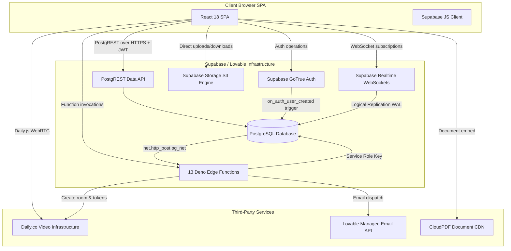
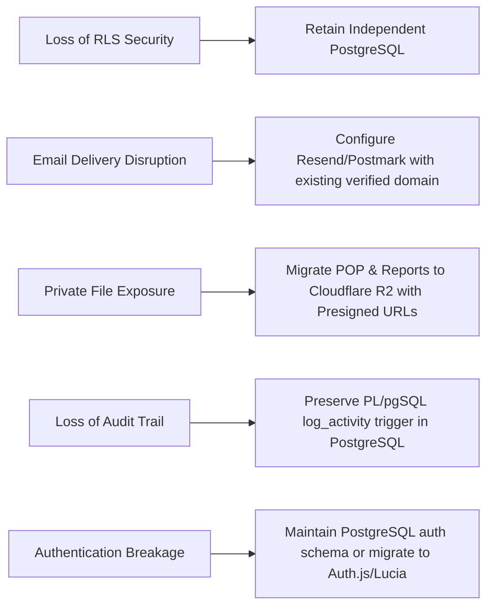

# ISM PRAYER NETWORK — COMPLETE TECHNICAL MIGRATION AUDIT REPORT

**Date:** October 24, 2026  
**Target Architecture:** Cloudflare Pages, Cloudflare Workers, and Independent PostgreSQL Database  
**Source Platform:** Lovable (`ismprayernetwork.lovable.app`) / Supabase (`ryitxoymayasdlabojsx.supabase.co`)  
**Repository Inspected:** `therealbuccie/ismprayernetwork` (Revision `798a9c1`)  
**Audit Status:** Complete • Zero Code Modified • Read-Only Inspection  

---

## Executive Summary & Database Recommendation

### Architectural Verdict: Cloudflare D1 vs. Independently Hosted PostgreSQL

> [!IMPORTANT]
> **Definitive Recommendation: Independently Hosted PostgreSQL (e.g., Neon Serverless Postgres, Managed Supabase / Self-Hosted Supabase, or AWS RDS Postgres) is STRONGLY RECOMMENDED over Cloudflare D1.**

| Criterion | Cloudflare D1 (SQLite) | Independently Hosted PostgreSQL | Impact / Risk on Platform |
| :--- | :--- | :--- | :--- |
| **Row Level Security (RLS)** | ❌ Unsupported | ✅ Fully Supported (Native) | **Critical:** 36 tables enforce access control via PostgreSQL RLS. Without RLS, all client queries must be rewritten into custom API worker proxies. |
| **Direct Browser Client Queries** | ❌ Impossible (No client library with RLS) | ✅ Supported via PostgREST / Supabase Client | **Critical:** 33 frontend pages and 32 admin modules query database directly with user JWT. D1 requires complete frontend data-access rewrite. |
| **Procedural Logic & Triggers** | ❌ Basic SQL triggers only; No PL/pgSQL | ✅ Native PL/pgSQL & Procedural Triggers | **Critical:** 8+ PL/pgSQL functions and triggers (notably `log_activity()` auditing 24 tables with JSON diffs) cannot run on D1. |
| **PostgreSQL Extensions** | ❌ None | ✅ `pg_net`, `pgmq`, `uuid-ossp`, `pg_trgm` | **High:** App relies on `net.http_post` for signup hooks and `pgmq` for mail dispatch queuing. |
| **Advanced Data Types** | ❌ Missing `UUID`, `JSONB`, `TIMESTAMPTZ`, `TEXT[]`, `NUMERIC(10,2)` | ✅ Full Native Support | **High:** Data truncation and precision loss in financial fields (`books.price`, `orders.total_amount`) and arrays (`activity_logs.changed_fields`). |
| **Realtime CDC Subscriptions** | ❌ No WebSocket change feed | ✅ Logical Replication / `postgres_changes` | **High:** Prayer rooms and participant rosters rely on real-time database changes. |
| **Bulk Batch Write Concurrency** | ⚠️ Single-writer bottleneck (SQLite WAL) | ✅ High-concurrency MVCC | **Medium:** Mail dispatch tracking (500 recipients at once) and batch CSV contact imports (thousands of rows) cause lock contention on D1. |

**Conclusion:** Migrating to Cloudflare D1 would effectively require a **ground-up rewrite** of the entire database, authorization layer, real-time sync, and data-fetching architecture across 65+ React components. Conversely, an **independent PostgreSQL database** paired with **Cloudflare Pages** (frontend hosting) and **Cloudflare Workers** (API & Edge Functions) preserves 100% of schema integrity, RLS policies, trigger-based audit logs, and existing client-side query patterns, reducing migration effort and operational risk by more than 80%.

---

## 1. Frontend Architecture

### 1.1 Core Framework & Tooling
- **Framework:** React 18.3.1
- **Language / Typing:** TypeScript 5.8.3
- **Build Tool:** Vite 5.4.19 with `@vitejs/plugin-react-swc` (Speedy Web Compiler)
- **Styling Engine:** Tailwind CSS 3.4.17 with `tailwindcss-animate` and `@tailwindcss/typography`
- **UI Architecture:** Radix UI Primitives (49 individual shadcn-style component wrappers)
- **State & Server Cache:** `@tanstack/react-query` 5.83.0 (configured with 5-minute `staleTime` and disabled window focus refetching)
- **Routing:** `react-router-dom` 6.30.1 (Single Page Application, browser history routing)
- **Animation:** `framer-motion` 12.34.3
- **3D Visualization:** `three` 0.170.0, `@react-three/fiber` 8.18.0, `@react-three/drei` 9.122.0
- **Media Streaming:** `hls.js` 1.6.15 for live HLS video playback
- **Video Conferencing:** `@daily-co/daily-js` 0.87.0
- **Document Rendering:** CloudPDF Web Viewer SDK (loaded via CDN script)
- **Data Export:** `xlsx` 0.18.5 (Excel/CSV generation)
- **Form Handling & Validation:** `react-hook-form` 7.61.1 with `@hookform/resolvers` 3.10.0 and `zod` 3.25.76

### 1.2 Route Map & Page Inventory
The application defines 33 routes in `src/App.tsx`:

| Path | Component / Page | Access Control | Primary Features |
| :--- | :--- | :--- | :--- |
| `/` | `Index.tsx` | Public | Hero with 3D Globe, Live stream banner, quick actions, testimonials, promo modals |
| `/auth` | `Auth.tsx` | Public / Guest | Email/password login, register with role metadata, password reset request |
| `/join` | `Join.tsx` | Public | Ministerial onboarding form, bio, calling, church details, country selection |
| `/prayer-requests` | `PrayerRequests.tsx` | Public read, Auth write | Filterable prayer requests (by category/status), "I am Praying" counter, submit request, link testimony |
| `/groups` | `PrayerGroups.tsx` | Public | Explore public/private prayer groups, search by name/region, member counts |
| `/groups/:slug` | `JoinGroup.tsx` | Public / Member | Group details, join/leave group, launch live WebRTC prayer room call (`<VideoCall />`) |
| `/prayer-room` | `PrayerRoom.tsx` | Public / Auth | 24/7 Global prayer room lobby, synced live schedule countdown, active intercessors |
| `/prayer-room/:slug` | `JoinPrayerRoom.tsx` | Public / Auth | Live hosted prayer room session, synchronized 15-minute countdown, HLS stream, participant roster |
| `/testimonies` | `Testimonies.tsx` | Public read, Auth submit | Approved praise reports, filter by category, submit text/video testimony |
| `/live-tv` | `LiveTV.tsx` | Public | HLS live video stream player (`hls.js`), program schedule, social sharing |
| `/radio` | `OnlineRadio.tsx` | Public | Live audio stream player, animated audio visualizer waves, background ambience |
| `/partner` | `Partner.tsx` | Public | Ministry partnership options, tier information, giving instructions |
| `/contact` | `Contact.tsx` | Public | General contact form, subject categorization, database submission |
| `/bookstore` | `Bookstore.tsx` | Public | Digital and physical book catalog, combo packs, multi-currency display (USD, ESPEES, NGN), cart |
| `/global-prayer-map` | `GlobalPrayerMap.tsx` | Public | Continental breakdown of intercessors, prayer requests, regional impact statistics |
| `/prayer-points` | `PrayerPoints.tsx` | Public | Categorized daily and weekly prayer outlines, scripture references |
| `/admin` | `AdminHub.tsx` | Super-Admin / Admin | Master administrative dashboard (32 modular management interfaces) |
| `/dashboard` | `Dashboard.tsx` | Authenticated | Member dashboard, profile edit, my prayer groups, prayer slots, submitted requests |
| `/prayer-dashboard` | `PrayerDashboard.tsx` | Authenticated | Individual prayer time metrics, weekly streak, logged minutes |
| `/api/dashboard` | `PublicDashboard.tsx` | PIN Protected (`ADMIN_PIN`) | Standalone admin portal protected by session PIN gate bypassing Supabase Auth login |
| `/api/prayer-dashboard`| `PublicPrayerDashboard.tsx` | PIN Protected (`ADMIN_PIN`) | Standalone prayer coordination portal |
| `/api/bookstore` | `PublicBookstoreDashboard.tsx`| PIN Protected (`ADMIN_PIN`) | Standalone bookstore inventory & orders portal |
| `/events` | `Events.tsx` | Public | Upcoming minister conferences, summits, and prayer rallies |
| `/programs` | `Programs.tsx` | Public | Major programs (e.g. Reach Ministers Program, Global Ministers Classroom) |
| `/about` | `About.tsx` | Public | Vision, mission, history of the ISM Ministers Prayer Network |
| `/our-impact` | `OurImpact.tsx` | Public | Global outreach statistics, participating nations, testimonies |
| `/my-library` | `MyLibrary.tsx` | Authenticated | Digital bookshelf for purchased books, DRM protected CloudPDF viewer |
| `/api-docs` | `ApiDocs.tsx` | Public | Interactive documentation for Partner API v1 |
| `/api-key-doc` | `ApiKeyDocument.tsx` | Public | Printable API credential documentation and integration guides |
| `/archives` | `Archives.tsx` | Public | Catalog of previous prayer meetings and broadcasts |
| `/unsubscribe` | `Unsubscribe.tsx` | Public (Token-based) | Token-verified email unsubscribe handler |
| `/report` | `SubmitReport.tsx` | Authenticated | Minister weekly/monthly activity report submission with file upload |
| `*` | `NotFound.tsx` | Public | Custom 404 page with navigation fallbacks |

### 1.3 Key Component Architecture
- **Interactive 3D Globe (`HeroGlobe.tsx`):** Built with Three.js, React Three Fiber, and Drei. Implements custom shaders with mesh distortion materials and animated rotation.
- **Video & Audio Calling (`VideoCall.tsx`):** Integrates Daily.co iframe-less call object. Features include:
  - Participant video/audio grid with active speaker detection
  - In-meeting text chat over Daily.co Data Channels (`app-message`)
  - Real-time hand raising queue
  - Moderator mute controls and "Mute All" capabilities
  - Adaptive bitrate configuration reacting to `network-quality-change`
  - Automated session persistence into `group_call_participations`
- **Bookstore & Checkout Flow (`CheckoutModal.tsx`, `CartContext.tsx`):**
  - Multi-currency engine (USD `$`, ESPEES `E₱`, NGN `₦`)
  - Configurable multi-region bank accounts loaded from `site_settings`
  - Direct integration with KingsPay and ESPEES transaction codes
  - File upload for Proof of Payment (POP) receipts
- **Protected PDF Viewer (`FullScreenReader` in `MyLibrary.tsx`):**
  - CloudPDF.io embedded canvas
  - Dynamic user email and name watermarking
  - Focus and blur event listeners to mitigate screen recording and screenshots
- **Multilingual System (`LanguageSelector.tsx`, `FloatingTranslate.tsx`):**
  - Google Translate widget integration driven by `googtrans` cookie injection and DOM change dispatching across 60+ languages.

### 1.4 Asset & Build Analysis
- **Build Artifacts:** Single Page Application output into `dist/`.
- **Pre-build Script:** `scripts/generate-sitemap.ts` runs automatically on `prebuild` and `predev` to emit `public/sitemap.xml`.
- **Large Static Assets:**
  - `public/video/hero-bg.mp4`: 14.6 MB
  - `public/audio/tongues.mp3`: 3.7 MB
  - `src/assets/*.png`: ~15 MB of high-resolution promotional banners and branding graphics.
- **Build Configurations:**
  - `vite.config.ts` currently imports `componentTagger` from `lovable-tagger` (must be pruned).
  - PostCSS and Tailwind configured via `postcss.config.js` and `tailwind.config.ts`.

---

## 2. Backend Architecture

### 2.1 Lovable & Supabase Integration Topology



### 2.2 Edge Functions Inventory
Located in `supabase/functions/` (Deno runtime):

| Function Name | JWT Verification | Permissions / Secrets Required | Purpose & External Dependencies |
| :--- | :--- | :--- | :--- |
| `admin-create-user` | Enforced in code | `SUPABASE_SERVICE_ROLE_KEY` | Creates users with administrative roles via Supabase Admin Auth API. |
| `auth-email-hook` | Disabled (`verify_jwt = false`) | `LOVABLE_API_KEY`, `LOVABLE_SEND_URL` | Supabase Auth Custom Email Hook. Renders React Email templates and sends via `@lovable.dev/email-js`. |
| `daily-room` | Disabled | `DAILY_API_KEY`, `SUPABASE_SERVICE_ROLE_KEY` | Calls Daily.co REST API to check/create WebRTC rooms and generate participant/moderator tokens. |
| `dashboard-admin` | Disabled (Uses PIN) | `ADMIN_PIN`, `SUPABASE_SERVICE_ROLE_KEY` | Admin proxy router allowing full CRUD and analytics across 24 tables using `ADMIN_PIN`. |
| `bookstore-admin` | Enforced (Uses PIN) | `ADMIN_PIN`, `SUPABASE_SERVICE_ROLE_KEY` | Specialized CRUD proxy for books and categories. |
| `send-dispatch-email` | Disabled (Uses PIN) | `ADMIN_PIN`, `LOVABLE_API_KEY`, `SUPABASE_SERVICE_ROLE_KEY` | Bulk mail dispatch (up to 500 recipients). Rewrites URLs for click tracking, injects tracking pixel, sends via Lovable. |
| `send-welcome-email` | Disabled | `LOVABLE_API_KEY`, `SUPABASE_SERVICE_ROLE_KEY` | Triggered by DB via `pg_net` when a user profile is created. Sends templated welcome email. |
| `track-email` | Public | `SUPABASE_SERVICE_ROLE_KEY` | Serves 1x1 transparent GIF for open tracking (`?t=open`) and 302 redirects for click tracking (`?t=click`). |
| `email-unsubscribe-link`| Disabled | `LOVABLE_API_KEY`, `SUPABASE_SERVICE_ROLE_KEY` | Validates unsubscribe token, syncs with Lovable suppression API, and writes to `suppressed_emails`. |
| `handle-email-events` | Webhook (Signature verified) | `LOVABLE_API_KEY`, `SUPABASE_SERVICE_ROLE_KEY` | Ingests bounce, complaint, and unsubscribe webhooks from Lovable email service. |
| `partner-api` | Disabled (API Key) | `PARTNER_API_KEY`, `SUPABASE_SERVICE_ROLE_KEY` | Full REST API v1 for third-party partners (books, contacts, reports, analytics, orders). |
| `prayer-reminder` | Enforced | `LOVABLE_API_KEY`, `SUPABASE_SERVICE_ROLE_KEY` | Scheduled worker inspecting `prayer_slots` 25-35 minutes ahead and triggering reminders. |
| `preview-transactional-email` | Disabled | `LOVABLE_API_KEY` | Renders registered React Email templates for development preview. |

---

## 3. Database Architecture & Schema Specification

The database consists of **36 public tables**, extensive indexes, foreign keys, 8+ PL/pgSQL stored procedures, dynamic triggers, and Row Level Security on all tables.

### 3.1 Comprehensive Table Inventory

```
+---------------------------+-----------------------------------------------------------------------------------------------------------------------+
| Table Name                | Columns (Name & Type)                                                                                                 |
+---------------------------+-----------------------------------------------------------------------------------------------------------------------+
| activity_logs             | id (uuid PK), created_at (timestamptz), actor_id (uuid), actor_email (text), actor_role (text), action (text),        |
|                           | table_name (text), record_id (text), record_label (text), changed_fields (text[]), old_data (jsonb), new_data (jsonb)|
+---------------------------+-----------------------------------------------------------------------------------------------------------------------+
| announcements             | id (uuid PK), title (text), body (text), category (text), image_url (text), is_active (bool), archived (bool),        |
|                           | published_at (timestamptz), created_by (text), created_at (timestamptz), updated_at (timestamptz)                    |
+---------------------------+-----------------------------------------------------------------------------------------------------------------------+
| birthday_wishes           | id (uuid PK), event_id (uuid FK -> events.id), user_id (uuid), author_name (text), message (text),                   |
|                           | created_at (timestamptz)                                                                                              |
+---------------------------+-----------------------------------------------------------------------------------------------------------------------+
| books                     | id (uuid PK), title (text), subtitle (text), author (text), short_description (text), description (text),             |
|                           | cover_image_url (text), price (numeric 10,2), espees_price (numeric), ngn_price (numeric), is_digital (bool),         |
|                           | is_physical (bool), digital_file_url (text), cloudpdf_document_id (text), category_id (uuid FK -> categories.id),    |
|                           | stock (int), pages (int), isbn (text), featured (bool), created_at (timestamptz), updated_at (timestamptz)           |
+---------------------------+-----------------------------------------------------------------------------------------------------------------------+
| campaigns                 | id (uuid PK), title (text), description (text), link_url (text), display_type (text), images (jsonb),                |
|                           | is_active (bool), created_at (timestamptz), updated_at (timestamptz)                                                  |
+---------------------------+-----------------------------------------------------------------------------------------------------------------------+
| categories                | id (uuid PK), name (text UNIQUE), created_at (timestamptz)                                                            |
+---------------------------+-----------------------------------------------------------------------------------------------------------------------+
| combo_packs               | id (uuid PK), title (text), short_description (text), description (text), cover_image_url (text),                     |
|                           | price (numeric), espees_price (numeric), ngn_price (numeric), is_active (bool), featured (bool),                      |
|                           | created_at (timestamptz), updated_at (timestamptz)                                                                    |
+---------------------------+-----------------------------------------------------------------------------------------------------------------------+
| combo_pack_items          | id (uuid PK), combo_pack_id (uuid FK -> combo_packs.id), book_id (uuid FK -> books.id)                                |
+---------------------------+-----------------------------------------------------------------------------------------------------------------------+
| contact_messages          | id (uuid PK), name (text), email (text), message (text), created_at (timestamptz)                                     |
+---------------------------+-----------------------------------------------------------------------------------------------------------------------+
| contacts                  | id (uuid PK), first_name (text), last_name (text), email (text), phone (text), title (text),                          |
|                           | ministerial_role (text), country (text), city (text), group_name (text), source (text), notes (text),                |
|                           | dob_day (int), dob_month (int), created_at (timestamptz), updated_at (timestamptz)                                   |
+---------------------------+-----------------------------------------------------------------------------------------------------------------------+
| email_send_log            | id (uuid PK), message_id (text), template_name (text), recipient_email (text), status (text),                         |
|                           | error_message (text), metadata (jsonb), created_at (timestamptz)                                                      |
+---------------------------+-----------------------------------------------------------------------------------------------------------------------+
| email_send_state          | id (int PK), batch_size (int), send_delay_ms (int), retry_after_until (timestamptz),                                  |
|                           | transactional_email_ttl_minutes (int), auth_email_ttl_minutes (int), updated_at (timestamptz)                         |
+---------------------------+-----------------------------------------------------------------------------------------------------------------------+
| email_unsubscribe_tokens  | id (uuid PK), email (text), token (text), used_at (timestamptz), created_at (timestamptz)                              |
+---------------------------+-----------------------------------------------------------------------------------------------------------------------+
| events                    | id (uuid PK), minister_name (text), birthday_month (int), birthday_day (int), minister_image_url (text),             |
|                           | description (text), created_by (text), created_at (timestamptz)                                                       |
+---------------------------+-----------------------------------------------------------------------------------------------------------------------+
| group_call_participations | id (uuid PK), group_id (uuid FK -> prayer_groups.id), user_id (uuid), participant_name (text), joined_at (timestamptz)|
|                           | left_at (timestamptz), duration_seconds (int), created_at (timestamptz)                                               |
+---------------------------+-----------------------------------------------------------------------------------------------------------------------+
| group_members             | id (uuid PK), group_id (uuid FK -> prayer_groups.id CASCADE), user_id (uuid), joined_at (timestamptz)                  |
+---------------------------+-----------------------------------------------------------------------------------------------------------------------+
| group_prayer_assignments  | id (uuid PK), group_id (uuid FK -> prayer_groups.id), prayer_point_id (uuid FK -> prayer_points.id),                  |
|                           | sent_by (text), created_at (timestamptz)                                                                              |
+---------------------------+-----------------------------------------------------------------------------------------------------------------------+
| newsletter_subscribers    | id (uuid PK), email (text UNIQUE), full_name (text), is_active (bool), subscribed_at (timestamptz)                    |
+---------------------------+-----------------------------------------------------------------------------------------------------------------------+
| prayer_groups             | id (uuid PK), name (text), description (text), slug (text UNIQUE), is_public (bool), created_by (uuid),               |
|                           | member_count (int), created_at (timestamptz)                                                                          |
+---------------------------+-----------------------------------------------------------------------------------------------------------------------+
| prayer_interactions       | id (uuid PK), prayer_request_id (uuid FK -> prayer_requests.id CASCADE), user_id (uuid), created_at (timestamptz)    |
+---------------------------+-----------------------------------------------------------------------------------------------------------------------+
| prayer_points             | id (uuid PK), title (text), body (text), category (text), scripture (text), sort_order (int), is_active (bool),      |
|                           | archived (bool), created_at (timestamptz), updated_at (timestamptz)                                                   |
+---------------------------+-----------------------------------------------------------------------------------------------------------------------+
| prayer_reports            | id (uuid PK), user_id (uuid), minister_name (text), church (text), prayer_date (date), attendance (int),              |
|                           | notes (text), contact_email (text), file_url (text), file_name (text), status (text), admin_note (text),              |
|                           | created_at (timestamptz), updated_at (timestamptz)                                                                    |
+---------------------------+-----------------------------------------------------------------------------------------------------------------------+
| prayer_requests           | id (uuid PK), title (text), description (text), category (text), author_name (text), user_id (uuid),                  |
|                           | prayer_count (int), is_anonymous (bool), status (text: submitted|praying|answered), response_text (text),             |
|                           | responded_by (uuid), responded_at (timestamptz), created_at (timestamptz)                                             |
+---------------------------+-----------------------------------------------------------------------------------------------------------------------+
| prayer_room_participants  | id (uuid PK), session_id (uuid FK -> prayer_room_sessions.id), full_name (text), location (text),                    |
|                           | joined_at (timestamptz)                                                                                               |
+---------------------------+-----------------------------------------------------------------------------------------------------------------------+
| prayer_room_sessions      | id (uuid PK), slug (text UNIQUE), owner_id (uuid), owner_name (text), timer_started_at (timestamptz),                 |
|                           | is_active (bool), created_at (timestamptz)                                                                            |
+---------------------------+-----------------------------------------------------------------------------------------------------------------------+
| prayer_slots              | id (uuid PK), user_id (uuid), user_name (text), user_email (text), slot_date (date), slot_time (text),                |
|                           | status (text), reminder_sent (bool), created_at (timestamptz)                                                         |
+---------------------------+-----------------------------------------------------------------------------------------------------------------------+
| prayer_weeks              | id (uuid PK), title (text), week_start (date), intro (text), affirmations (text), conclusion (text), points (jsonb),  |
|                           | song_title (text), song_artist (text), song_lyrics (text), song_url (text), confession_topic (text),                  |
|                           | confession_scripture (text), is_active (bool), archived (bool), created_by (uuid), created_at, updated_at             |
+---------------------------+-----------------------------------------------------------------------------------------------------------------------+
| profiles                  | id (uuid PK), user_id (uuid UNIQUE -> auth.users.id CASCADE), email (text), full_name (text), role (text),           |
|                           | ministry_name (text), ministerial_role (text), title (text), phone (text), country (text), city (text),               |
|                           | dob_day (int), dob_month (int), created_at (timestamptz)                                                              |
+---------------------------+-----------------------------------------------------------------------------------------------------------------------+
| program_dispatches        | id (uuid PK), program_id (uuid FK -> programs.id), program_title (text), subject (text), recipient_count (int),      |
|                           | match_mode (text: auto|manual), sent_at (timestamptz), created_at, updated_at                                         |
+---------------------------+-----------------------------------------------------------------------------------------------------------------------+
| program_engagements       | id (uuid PK), dispatch_id (uuid FK -> program_dispatches.id), program_id (uuid FK -> programs.id), email (text),     |
|                           | full_name (text), country (text), sent_at (timestamptz), opened_at (timestamptz), open_count (int),                  |
|                           | clicked_at (timestamptz), click_count (int), created_at, updated_at                                                   |
+---------------------------+-----------------------------------------------------------------------------------------------------------------------+
| programs                  | id (uuid PK), title (text), description (text), event_date (timestamptz), location (text), image_url (text),         |
|                           | video_url (text), registration_url (text), is_upcoming (bool), created_by (text), created_at (timestamptz)            |
+---------------------------+-----------------------------------------------------------------------------------------------------------------------+
| purchase_orders           | id (uuid PK), user_id (uuid), items (jsonb), total_amount (numeric), payment_method (text), espees_code (text),       |
|                           | pop_image_url (text), status (text: pending|approved|rejected), admin_note (text), created_at, updated_at            |
+---------------------------+-----------------------------------------------------------------------------------------------------------------------+
| purchases                 | id (uuid PK), user_id (uuid), book_id (uuid FK -> books.id), format (text), amount (numeric), status (text),         |
|                           | stripe_payment_id (text), granted_by (text), created_at (timestamptz)                                                 |
+---------------------------+-----------------------------------------------------------------------------------------------------------------------+
| site_settings             | id (uuid PK), key (text UNIQUE), value (jsonb), updated_at (timestamptz)                                              |
+---------------------------+-----------------------------------------------------------------------------------------------------------------------+
| suppressed_emails         | id (uuid PK), email (text UNIQUE), reason (text: bounce|complaint|unsubscribe), metadata (jsonb), created_at          |
+---------------------------+-----------------------------------------------------------------------------------------------------------------------+
| testimonies               | id (uuid PK), user_id (uuid), prayer_request_id (uuid FK -> prayer_requests.id SET NULL), title (text),               |
|                           | content (text), author_name (text), location (text), video_url (text), is_approved (bool), created_at (timestamptz)  |
+---------------------------+-----------------------------------------------------------------------------------------------------------------------+
```

### 3.2 Stored Procedures & Triggers
1. **`update_updated_at_column()`**: Standard timestamp trigger attached to `books`, `campaigns`, `combo_packs`, `contacts`, `announcements`, `prayer_reports`, `prayer_weeks`, `program_dispatches`, `program_engagements`.
2. **`get_user_role(uuid)`**: Returns the user's role from `profiles`.
3. **`is_admin(uuid)`**: Returns boolean (`true` if role in `'admin'`, `'super-admin'`).
4. **`handle_new_user()`**: Trigger on `auth.users` after insert. Automatically creates a `profiles` entry and sets `'super-admin'` if email matches `'stacomzy20@gmail.com'`.
5. **`increment_prayer_count()`**: Trigger on `prayer_interactions` after insert. Atomically increments `prayer_requests.prayer_count`.
6. **`update_group_member_count()`**: Trigger on `group_members` after insert or delete. Automatically adjusts `prayer_groups.member_count`.
7. **`auto_subscribe_new_user()`**: Trigger on `auth.users` insert. Inserts email into `newsletter_subscribers`.
8. **`sync_profile_to_contacts()`**: Trigger on `profiles` insert/update. Keeps minister contacts synchronized in the global directory.
9. **`send_welcome_email_on_signup()`**: Trigger on `profiles` insert. Dispatches an async HTTP POST request using `net.http_post` (`pg_net` extension) to edge function `send-welcome-email`.
10. **`log_activity()`**: Trigger attached to **24 tables**. Dynamically extracts changed fields, compares `to_jsonb(OLD)` and `to_jsonb(NEW)`, and writes to `activity_logs`.
11. **`validate_prayer_request_status()`**: Validates status field is strictly in `('submitted', 'praying', 'answered')`.

### 3.3 Elements Not Determinable From the Repository Alone
- **Missing PGMQ Migration:** Migration `20261005104302` modifies 4 functions (`move_to_dlq`, `read_email_batch`, `enqueue_email`, `delete_email`) setting search path to `public, pgmq`. The base migration creating these 4 functions and the PGMQ message queue schema was created directly on the database and is missing from version control.
- **Uncommitted Storage Bucket Creation:** Storage bucket `report-uploads` has RLS policies in migration `20260730110713`, but the initial `INSERT INTO storage.buckets` statement was omitted (created manually in the console).
- **Active Database Extensions:** Unknown list of active extensions in Supabase production (e.g., `pg_cron`, `pg_stat_statements`, `http`).
- **Production Data Volumes:** Table row counts, storage object counts, total file volumes across buckets.
- **Scheduled pg_cron Entries:** Any cron jobs configured via `cron.schedule()` directly in SQL for `prayer-reminder` or cleanup.

---

## 4. Authentication Architecture

### 4.1 Authentication Methods & Flows
- **Authentication Provider:** Supabase GoTrue Auth.
- **Primary Mechanism:** Email & Password (`supabase.auth.signInWithPassword`, `supabase.auth.signUp`).
- **Session Handling:** Stored in browser `localStorage`.
- **Lovable Preview Session Broker:** `src/integrations/supabase/previewAuthStorage.ts` contains fallback code that shares auth tokens via `window.parent.postMessage` when framed inside the Lovable web editor. In standalone production, it defaults to standard `localStorage`.
- **User Roles:**
  - `customer`: Default role for all newly registered ministers.
  - `admin`: Standard administrator (can manage books, requests, groups, testimonies).
  - `super-admin`: Full platform control. Hardcoded bootstrap trigger in database assigns `super-admin` to `stacomzy20@gmail.com`. Super-admins can create other admins via `admin-create-user`.
- **Dual Authentication Vector (Admin PIN Gate):**
  - Standalone admin portals (`/api/dashboard`, `/api/prayer-dashboard`, `/api/bookstore`) bypass user login completely and authenticate via a 4-digit PIN stored in `sessionStorage` (`ADMIN_PIN` environment variable). This calls Edge Function `dashboard-admin` using the `SUPABASE_SERVICE_ROLE_KEY`.

### 4.2 Auth Custom Email Hook
- The application overrides default Supabase transactional emails with Edge Function `auth-email-hook`.
- Handles `signup`, `invite`, `magiclink`, `recovery`, `email_change`, and `reauthentication` using React Email templates rendered server-side and sent through `@lovable.dev/email-js`.

---

## 5. Storage Architecture

### 5.1 Storage Buckets Specification

| Bucket Name | Visibility | File Types | Size Limits | Access Policies & RLS Rules |
| :--- | :--- | :--- | :--- | :--- |
| `book-covers` | Public | Images (`.jpg`, `.png`, `.webp`) | 5 MB (client-side enforced) | Public read. Authenticated users and admins can upload and manage book and combo pack covers. |
| `pop-uploads` | Private | Images / Documents (Proof of Payment) | Uncapped in client | Authenticated users upload to folder `${auth.uid()}/...`. Only the owning user and admins can view via short-lived signed URLs (600s). |
| `report-uploads` | Private | Reports / Docs / Spreadsheets | 15 MB (enforced in `SubmitReport.tsx`) | Authenticated users upload to folder `${auth.uid()}/...`. Only the submitting minister and admins can view via signed URLs (3600s). |

---

## 6. Real-Time & Media Services Architecture

### 6.1 Real-Time Subscriptions (Supabase Realtime)
The frontend opens WebSocket connections to Supabase Realtime for three critical flows:
1. **Prayer Slot Coordination (`PrayerRoom.tsx`):**
   - Subscribes to `postgres_changes` on `prayer_slots` and `prayer_room_sessions` to refresh current intercessors in real time.
2. **Session Participant Roster (`PrayerRoom.tsx` & `JoinPrayerRoom.tsx`):**
   - Subscribes to `INSERT` on `prayer_room_participants` filtered by `session_id=eq.{id}`. Automatically pops toast notifications when a new minister joins and invalidates the query cache.
3. **Synchronized Prayer Timers:**
   - Instead of a standalone WebSocket server, session synchronization relies on `prayer_room_sessions.timer_started_at`. The host writes a timestamp, and all participant browsers compute remaining time locally against system clocks, polled/refetched on session updates.

### 6.2 Video Conferencing & Audio
- **WebRTC Group Calls:** Implemented using **Daily.co** (`@daily-co/daily-js`), NOT LiveKit.
  - Backed by Edge Function `daily-room`, which communicates with Daily.co REST APIs.
  - In-meeting signaling, chat messages, and hand-raising rely on Daily.co `sendAppMessage` data channels.
  - Moderator capabilities: Group creators or platform admins receive Daily owner tokens permitting remote participant muting.
- **Live TV Streaming:**
  - Standard `<video>` element managed by `hls.js` playing HLS streams loaded dynamically from `site_settings.hls_url`.
- **Online Radio:**
  - HTML5 `<audio>` player streaming audio (`/audio/tongues.mp3` or external stream) accompanied by Framer Motion animated waveform rings.

---

## 7. External Integrations & Third-Party Services

| Service | Integration Point | Purpose | Credentials / Secrets Needed |
| :--- | :--- | :--- | :--- |
| **Daily.co** | Edge Function `daily-room`, Frontend `VideoCall.tsx` | WebRTC audio/video group prayer rooms | `DAILY_API_KEY` |
| **Lovable Managed Email** | Edge Functions `auth-email-hook`, `send-dispatch-email`, `send-welcome-email`, `email-unsubscribe-link`, `handle-email-events` | Transactional & bulk email delivery via `notify.ismprayernetwork.org` | `LOVABLE_API_KEY`, `LOVABLE_SEND_URL` |
| **CloudPDF.io** | Frontend `MyLibrary.tsx` | Digital DRM document viewer with screenshot blurring and watermarking | None (Uses document ID and public viewer script) |
| **Google Translate** | `index.html`, `LanguageSelector.tsx` | Dynamic client-side site translation into 60+ languages | None (Uses Google Translate Element script) |
| **KingsPay & ESPEES** | Frontend `CheckoutModal.tsx`, Edge Function `partner-api` | Mobile ministry payments and Espees digital currency processing | Bank/merchant account codes (`CEISM2`, `ISMNT/ISMOP`) |
| **Partner API (External Consumers)** | Edge Function `partner-api`, `ApiKeyDocument.tsx` | Headless REST API for ministry partners | `PARTNER_API_KEY` (`x-api-key` header) |

---

## 8. Feature & Capability Inventory

### 8.1 Public & Member Features
- **Global Landing Page:** Hero section with 3D interactive globe, live TV highlight, weekly prayer bulletin preview, featured books, testimonials, and regional prayer stats.
- **Prayer Wall & Intercession:** Submit requests (anonymous or named), real-time "Praying" counter, categorized filtering, official coordinator responses, and linked testimony sharing.
- **Prayer Groups:** Search and browse groups, group detail pages, membership enrollment, and 1-click group video prayer call launch.
- **24/7 Prayer Room:** Host a prayer slot, automated 15-minute prayer timer with synchronized participant display, and amen feedback.
- **Testimonies:** Browse approved praise reports, search by category, submit new testimonies with optional video links.
- **Media Center:** ISM Live TV streaming (HLS player) with scheduled programming guide, 24/7 online prayer radio with visualizer.
- **Online Bookstore & Library:** Browse books and combo packs, search and filter by category/format, multi-currency pricing, cart drawer, proof of payment upload, and DRM-protected digital reading room.
- **Ministerial Onboarding & Reporting:** Minister join form, profile management with country and birthday tracking, and monthly prayer report submissions with file attachments.

### 8.2 Administrative & Coordination Features (Admin Hub)
- **Database Contact Manager (`DatabaseManager.tsx`):** Enterprise-grade contact directory with pagination, search by country/alphabet/group, CSV import/export, and deduplication.
- **Mail Dispatch Manager (`MailDispatchManager.tsx`, `RichEmailComposer.tsx`):** Rich HTML email composer, targeted filtering (by country, source, alphabet, or individual contact), dispatch queue status, and program participation tracker.
- **Program Participation Tracker (`ProgramTrackerManager.tsx`):** Correlates dispatches, open tracking pixels, click redirects, and submitted prayer reports into an engagement scoring dashboard.
- **Weekly Prayer Bulletin Manager (`WeeklyPrayerManager.tsx`):** Author weekly prayer outlines, daily points, scripture references, affirmations, and worship songs.
- **Orders & Financial Management (`OrdersManager.tsx`, `PaymentSettingsManager.tsx`):** Review pending bookstore orders, inspect proof-of-payment receipts, approve/reject orders, grant library access, and configure multi-region bank accounts.
- **Content Management:** Create/edit/archive books, combo packs, categories, announcements, campaigns (banners/popups), events (birthdays), and prayer requests.
- **User & Role Administration (`UsersManager.tsx`):** Search registered profiles, inspect roles, and create new admin accounts.
- **Audit Activity Log (`ActivityLogManager.tsx`):** Searchable log of every insert, update, and delete across 24 tables with JSON diffs and actor attribution.

---

## 9. Cloudflare Migration Compatibility Matrix

| Platform Component | Current Implementation | Cloudflare Target | Migration Effort & Technical Strategy |
| :--- | :--- | :--- | :--- |
| **Web Frontend** | React + Vite SPA on Lovable | **Cloudflare Pages** | **Direct / Low Effort:** Build output (`dist/`) deploys directly. Remove `lovable-tagger` from `vite.config.ts`. Add `_routes.json` or fallback for SPA routing. |
| **Database** | PostgreSQL (Supabase) | **Independent PostgreSQL** (e.g. Neon, AWS RDS, Supabase Standalone) | **Recommended / Low-Medium Effort:** Direct `pg_dump` and `pg_restore`. Retains 100% of schema, RLS, functions, triggers, arrays, and JSONB. |
| **Database (Alternative)**| PostgreSQL (Supabase) | **Cloudflare D1** (SQLite) | **NOT Recommended / Critical Effort:** Ground-up rewrite of all 36 tables, loss of RLS, conversion of arrays/JSONB, and rewrite of 65+ UI components. |
| **Edge Functions** | 13 Deno Edge Functions | **Cloudflare Workers** | **Medium Effort:** Port Deno handlers (`Deno.serve`) to standard Fetch API (`export default { fetch }`). Replace `Deno.env.get` with Worker `env` bindings. |
| **Email Service** | Lovable Email SDK (`@lovable.dev/email-js`) | **Resend / Postmark / Cloudflare Email Workers** | **Redesign Required / Medium Effort:** Replace proprietary `@lovable.dev/email-js` SDK with Resend or Postmark API client. Configure SPF/DKIM/DMARC on `notify.ismprayernetwork.org`. |
| **File Storage** | Supabase Storage (3 buckets) | **Cloudflare R2** | **Redesign Required / Medium Effort:** Create 3 R2 buckets (`book-covers`, `pop-uploads`, `report-uploads`). Replace `supabase.storage` calls with AWS S3 SDK for presigned URLs and public R2 buckets. |
| **Video Conferencing**| Daily.co (`@daily-co/daily-js`) | **Daily.co** via Cloudflare Worker | **Direct / Low Effort:** Daily.co is independent. Edge Function `daily-room` moves directly to a Cloudflare Worker. |
| **Live TV / Audio** | HLS video (`hls.js`) & MP3 | **Cloudflare Stream / R2** | **Direct / Low Effort:** HLS player runs in-browser. Stream URL remains in settings. Static audio/video can reside in Cloudflare R2 or Pages assets. |
| **Realtime Subscriptions**| Supabase Realtime WebSockets | **Supabase Realtime / Cloudflare Durable Objects** | **Low Effort (if keeping Postgres):** Retain Supabase Realtime client. **High Effort (if decoupled):** Replace with Cloudflare Durable Objects + WebSockets. |
| **Scheduled Tasks** | `prayer-reminder` | **Cloudflare Workers Cron Triggers** | **Low Effort:** Add `triggers: { crons: ["*/10 * * * *"] }` in `wrangler.toml` to execute reminder job every 10 minutes. |

---

## 10. Technical Risk Assessment & Mitigation



### Risk 1: Incompatible Database Paradigm (PostgreSQL to D1 Conversion)
- **Risk Severity:** CRITICAL
- **Description:** Cloudflare D1 is SQLite. Attempting to convert the ISM Prayer Network schema to D1 will destroy Row Level Security, procedural triggers (especially `log_activity`), array types (`text[]`), and native JSONB operations. Furthermore, client-side queries will fail because D1 cannot be queried securely from the browser without an intermediate API layer.
- **Mitigation:** Deploy an independent PostgreSQL database (such as Neon or a standalone Supabase PostgreSQL instance) connected to Cloudflare Pages and Workers.

### Risk 2: Proprietary Email Vendor Lock-in (`@lovable.dev/email-js`)
- **Risk Severity:** HIGH
- **Description:** The email delivery system (transactional auth emails, welcome messages, and 500-recipient mail dispatches) is tightly coupled to Lovable's proprietary `@lovable.dev/email-js` library.
- **Mitigation:** Abstract email dispatch into a unified Cloudflare Worker module backed by an industry-standard provider (Resend or Postmark). Re-point DNS records for `notify.ismprayernetwork.org` to the new provider before cutover.

### Risk 3: Unauthorized Access to Private Receipts and Reports
- **Risk Severity:** HIGH
- **Description:** Payment proofs (`pop-uploads`) and pastoral ministry reports (`report-uploads`) contain sensitive personal and financial data. Currently, Supabase Storage RLS restricts access to folder owners and admins.
- **Mitigation:** Mirror this security model in Cloudflare R2 using AWS S3-compatible presigned URLs with 10-minute expiry for payment proofs and 60-minute expiry for report downloads. Ensure R2 buckets remain strictly private.

### Risk 4: Uncommitted Database Schema Objects
- **Risk Severity:** MEDIUM
- **Description:** The repository is missing the creation migration for PGMQ queue functions (`public.enqueue_email`, `public.read_email_batch`, `public.delete_email`, `public.move_to_dlq`) and the bucket record for `report-uploads`.
- **Mitigation:** Perform a full schema dump (`pg_dump --schema-only`) directly from the live Supabase database prior to migration to capture all live stored procedures, extensions, and tables.

---

## Recommended Step-by-Step Migration Roadmap

1. **Step 1 — Database Migration (Independent PostgreSQL):**
   - Extract full database dump (data and schema) from Supabase production: `pg_dump -h db.ryitxoymayasdlabojsx.supabase.co -U postgres -d postgres > ism_full_backup.sql`.
   - Restore onto the new independent PostgreSQL instance.
   - Verify all 36 tables, 8+ PL/pgSQL triggers, and RLS policies are intact.
2. **Step 2 — Storage Migration (Cloudflare R2):**
   - Create private R2 buckets for `pop-uploads` and `report-uploads`, and a public R2 bucket for `book-covers`.
   - Sync existing objects from Supabase storage into R2 via S3 CLI.
3. **Step 3 — Backend API Migration (Cloudflare Workers):**
   - Port the 13 Edge Functions to a unified Cloudflare Workers project using Hono or standard Worker routers.
   - Replace `@lovable.dev/email-js` with Resend/Postmark.
   - Configure Cloudflare Workers Cron Trigger for `prayer-reminder`.
4. **Step 4 — Frontend Pruning & Cloudflare Pages Deployment:**
   - Remove `lovable-tagger` from `package.json` and `vite.config.ts`.
   - Update `src/integrations/supabase/client.ts` environment variable mappings to target the independent database and Cloudflare Workers endpoints.
   - Deploy build output to Cloudflare Pages.
5. **Step 5 — DNS & Cutover:**
   - Cut over DNS records on Cloudflare (CNAME for Pages, API subdomains, and SPF/DKIM/DMARC for `notify.ismprayernetwork.org`).
   - Conduct live end-to-end verification of authentication, video calls, bookstore checkout, and mail dispatches.

---
*Report compiled autonomously by Antigravity Technical Migration Agent. No code was altered, no database was modified, and no credentials were exposed.*

