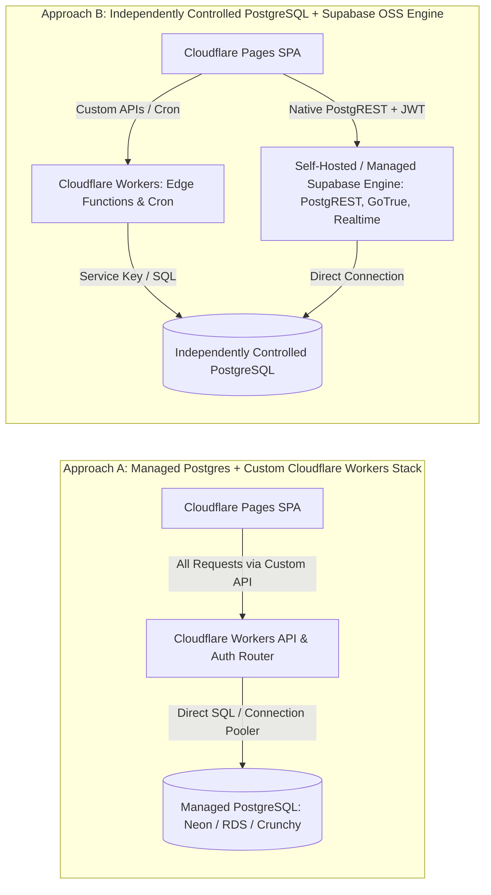

# MPN-001: SYSTEM ARCHITECTURE & DEPENDENCY SPECIFICATION

**Project:** ISM Prayer Network Platform Migration  
**Document ID:** MPN-001-ARCHITECTURE  
**Status:** Planning & Verification Milestone (Draft for Approval)  
**Target Environment:** Cloudflare Pages (Frontend), Cloudflare Workers (Backend & APIs), Independent PostgreSQL (Database), Cloudflare R2 (Storage)  
**Source Environment:** Lovable Cloud (`ismprayernetwork.lovable.app`) / Supabase (`ryitxoymayasdlabojsx.supabase.co`)  

---

## 1. Complete Dependency Map: Supabase & Lovable Integrations

The ISM Prayer Network platform exhibits tight integration with both the Supabase backend ecosystem and Lovable's proprietary platform tooling. This dependency map categorizes every touchpoint across the codebase.

```mermaid
flowchart TD
    subgraph Frontend [Frontend SPA - React 18 / Vite]
        ClientTS["src/integrations/supabase/client.ts"]
        PreviewAuth["src/integrations/supabase/previewAuthStorage.ts"]
        AuthCtx["src/contexts/AuthContext.tsx"]
        Hooks["src/hooks (useAuth, useBooks, usePurchases, etc.)"]
        Pages33["33 Pages (PrayerRoom, Bookstore, LiveTV, etc.)"]
        Admin32["32 Admin Modules (DatabaseManager, MailDispatch, etc.)"]
        LovableTagger["lovable-tagger (vite.config.ts & package.json)"]
    end

    subgraph BackendFunctions [Edge Functions (Deno Runtime)]
        AdminUser["admin-create-user"]
        AuthHook["auth-email-hook (@lovable.dev/email-js)"]
        DailyRoom["daily-room (Daily.co REST API)"]
        DashboardAdmin["dashboard-admin (Service Role Proxy)"]
        BookstoreAdmin["bookstore-admin (Service Role Proxy)"]
        MailDispatch["send-dispatch-email (Lovable Email SDK)"]
        WelcomeEmail["send-welcome-email (Lovable Email SDK)"]
        TrackEmail["track-email (Pixel & Click 302s)"]
        UnsubLink["email-unsubscribe-link"]
        EmailEvents["handle-email-events (Webhook)"]
        PartnerAPI["partner-api (Headless Partner REST API)"]
        PrayerReminder["prayer-reminder (Scheduled Cron)"]
        PreviewEmail["preview-transactional-email"]
    end

    subgraph DatabaseLayer [PostgreSQL Database (Supabase Cloud)]
        AuthUsers["auth.users / auth.identities"]
        Tables36["36 Public Tables"]
        RLSPolicies["Row Level Security (All Tables)"]
        TriggersPLPGSQL["PL/pgSQL Triggers (log_activity, handle_new_user, etc.)"]
        PGMQExt["pgmq Extension (Queueing)"]
        PGNetExt["pg_net Extension (HTTP Webhook)"]
        StorageEngine["storage.objects / storage.buckets"]
    end

    subgraph ExternalServices [External Integrations]
        DailyCoAPI["Daily.co WebRTC Video Calling"]
        LovableEmailService["Lovable Managed Email (notify.ismprayernetwork.org)"]
        CloudPDFCDN["CloudPDF.io Document DRM Viewer"]
        GoogleTranslate["Google Translate Client Widget"]
        MerchantGateways["KingsPay & ESPEES Code Gateways"]
    end

    Frontend -->|Direct PostgREST Queries| Tables36
    Frontend -->|Supabase GoTrue SDK| AuthUsers
    Frontend -->|Storage SDK Uploads & Signed URLs| StorageEngine
    Frontend -->|Realtime WebSockets (postgres_changes)| Tables36
    Frontend -->|Function Invocations| BackendFunctions
    Frontend -->|WebRTC Media Streams| DailyCoAPI
    Frontend -->|DRM PDF Viewer| CloudPDFCDN
    Frontend -->|Translation Widget| GoogleTranslate

    BackendFunctions -->|Service Role Key Access| Tables36
    BackendFunctions -->|Send Mail API| LovableEmailService
    BackendFunctions -->|Room Creation & Meeting Tokens| DailyCoAPI

    DatabaseLayer -->|net.http_post| WelcomeEmail
    DatabaseLayer -->|on_auth_user_created| Tables36
```

### 1.1 Frontend Dependencies
1. **SDK Imports & Clients:**
   - `@supabase/supabase-js` (^2.97.0) imported in `src/integrations/supabase/client.ts` and throughout `src/hooks/` and `src/pages/`.
   - `src/integrations/supabase/previewAuthStorage.ts`: Contains custom iframe postMessage broker code designed specifically for Lovable editor preview tabs. Defaults to `localStorage` when outside of Lovable preview zones.
   - `lovable-tagger` (^1.1.13): In `package.json` devDependencies and `vite.config.ts`. Injects HTML tracking tags for the Lovable visual editor.
2. **Authentication Consumer:**
   - `src/contexts/AuthContext.tsx`: Wraps `supabase.auth.onAuthStateChange`, `supabase.auth.getSession`, `supabase.auth.signInWithPassword`, `supabase.auth.signUp`, and `supabase.auth.signOut`.
   - Role evaluation relies directly on queries to `public.profiles` (`profile.role === 'admin' || profile.role === 'super-admin'`).
3. **Data Access Layer:**
   - 33 Pages and 32 Admin Dashboard components execute direct PostgREST table queries via the Supabase client:
     - `supabase.from("table").select(...)`
     - `supabase.from("table").insert(...)`
     - `supabase.from("table").update(...)`
     - `supabase.from("table").delete(...)`
   - Real-time event listeners using `supabase.channel()` in `PrayerRoom.tsx` and `JoinPrayerRoom.tsx` (`postgres_changes` on `prayer_slots`, `prayer_room_sessions`, and `prayer_room_participants`).
4. **Storage Operations:**
   - `supabase.storage.from("book-covers").upload(...)` in `CoverUpload.tsx`
   - `supabase.storage.from("pop-uploads").upload(...)` in `CheckoutModal.tsx`
   - `supabase.storage.from("pop-uploads").createSignedUrl(...)` in `OrdersManager.tsx`
   - `supabase.storage.from("report-uploads").upload(...)` in `SubmitReport.tsx`
   - `supabase.storage.from("report-uploads").createSignedUrl(...)` in `ReportsManager.tsx`
5. **Edge Function Invocations:**
   - `supabase.functions.invoke("daily-room", ...)` in `JoinGroup.tsx`
   - `supabase.functions.invoke("dashboard-admin", ...)` in `useBookstoreAdmin.ts` and `BookstorePinGate.tsx`
   - `supabase.functions.invoke("send-dispatch-email", ...)` in `MailDispatchManager.tsx`

### 1.2 Edge Functions Dependencies
The 13 Edge Functions in `supabase/functions/` run on the Deno runtime and rely on:
- `Deno.serve` HTTP server APIs.
- Environment variables: `SUPABASE_URL`, `SUPABASE_SERVICE_ROLE_KEY`, `LOVABLE_API_KEY`, `LOVABLE_SEND_URL`, `ADMIN_PIN`, `DAILY_API_KEY`, `PARTNER_API_KEY`.
- External libraries:
  - `npm:@lovable.dev/email-js@0.3.1`: Proprietary email sending, suppression checks, and webhook signature verification.
  - `npm:@react-email/components@0.0.22`: Server-side React email template rendering (`renderAsync`).
  - `https://esm.sh/@supabase/supabase-js@2`: Admin client for database operations bypassing RLS.

### 1.3 Database Dependencies
- **Auth Schema (`auth.users`):** Stores user credentials and generates UUIDs referenced by 11 public tables as foreign keys.
- **Extensions:**
  - `pg_net`: Asynchronous HTTP requests (`net.http_post`) to trigger `send-welcome-email` on user profile insertion.
  - `pgmq`: PostgreSQL Message Queue extension utilized for background transactional email dispatching and dead-letter queue management (`move_to_dlq`).
- **Procedural Logic:** 8+ PL/pgSQL functions that handle audit logs (`log_activity()`), user onboarding (`handle_new_user()`), and real-time counters (`increment_prayer_count()`).

---

## 2. Comparison of PostgreSQL Deployment Approaches

To host the database independently while migrating the frontend to Cloudflare Pages, two primary architectural paths exist.



### 2.1 Detailed Comparison Matrix

| Evaluation Dimension | Approach A: Managed PostgreSQL + Custom Cloudflare Workers Stack | Approach B: Independently Controlled PostgreSQL + Self-Hosted Supabase Engine | Analysis & Recommendation |
| :--- | :--- | :--- | :--- |
| **Architectural Model** | Pure custom API gateway in Cloudflare Workers querying PostgreSQL (via Neon serverless driver, Prisma, or Drizzle) | Independent PostgreSQL database with standard open-source Supabase microservices (PostgREST, GoTrue, Realtime, Storage) deployed on an independent VPS or container cluster | **Approach B preserves the client interface; Approach A requires a total frontend data-layer rewrite.** |
| **Frontend Code Changes** | **Massive Rewrite (65+ components):** Every `supabase.from("...").select()` must be replaced with custom API endpoints (`fetch("/api/...")`), manual state handling, and custom error formats. | **Zero Frontend Code Changes:** Only update `VITE_SUPABASE_URL` and `VITE_SUPABASE_PUBLISHABLE_KEY` in environment variables. All pages and hooks continue functioning identically. | **Approach B wins overwhelmingly on migration speed and safety.** |
| **Authentication Continuity** | High complexity: Must build a custom authentication worker handling password login, registration, JWT minting, refresh token rotation, and password reset tokens, while verifying legacy bcrypt hashes from `auth.users`. | **Perfect Continuity:** GoTrue is deployed against the restored `auth` schema. All existing user sessions, password hashes, and OAuth identities work immediately without forcing password resets. | **Approach B guarantees zero user disruption.** |
| **Row Level Security (RLS)** | **Compromised:** Cloudflare Workers connect using database credentials. Unless the Worker manually executes `SET LOCAL ROLE` and `SET LOCAL request.jwt.claims` for every transaction, RLS policies are bypassed, forcing security into application code. | **Fully Preserved:** PostgREST automatically verifies the caller's JWT and executes queries under the appropriate PostgreSQL role (`authenticated` or `anon`) with `auth.uid()` populated, enforcing all existing RLS rules natively. | **Approach B maintains defense-in-depth at the database level.** |
| **Realtime Functionality** | **High Rework:** Must re-architect prayer room coordination, participant rosters, and timers using Cloudflare Durable Objects + WebSockets, or third-party real-time providers (e.g. Ably/Pusher). | **Native Support:** Supabase Realtime service connects to PostgreSQL logical replication WAL and broadcasts `postgres_changes` over WebSockets to `PrayerRoom.tsx` and `JoinPrayerRoom.tsx`. | **Approach B requires zero real-time re-engineering.** |
| **Email Queueing & Workers** | Replaces `pgmq` with native **Cloudflare Queues** or Cron Workers. Highly scalable and decoupled from database CPU. | Retains `pgmq` within PostgreSQL or offloads to Cloudflare Workers with Cron Triggers. | **Approach A has cleaner worker queue ergonomics; Approach B works without changing existing database triggers.** |
| **Infrastructure Cost** | **$15 – $40 / month:**<br>• Neon Serverless Postgres: $0 – $20/mo<br>• Cloudflare Pages & Workers: $5/mo (Workers Paid)<br>• Resend/Postmark: $15 – $20/mo | **$25 – $55 / month:**<br>• VPS for Supabase Stack (Hetzner / DigitalOcean 8GB RAM): $15 – $30/mo<br>• Cloudflare Pages: $0/mo<br>• Resend/Postmark: $15 – $20/mo | **Costs are comparable ($10-15 variance). Approach B saves hundreds of engineering hours.** |
| **Maintenance Burden** | Low server maintenance (fully serverless), but high ongoing application code maintenance for custom API endpoints. | Moderate operational maintenance (managing Docker Compose / Coolify containers, OS security updates, and container monitoring). | **Approach A has lower DevOps overhead; Approach B has near-zero frontend engineering overhead.** |

---

## 3. Recommended Target Architecture: The High-Integrity Hybrid Model

To achieve complete independence from Lovable and Supabase Cloud while avoiding a high-risk multi-week rewrite of 65+ frontend components, the **High-Integrity Hybrid Model** is recommended:

```mermaid
flowchart TD
    subgraph EdgeTier [Cloudflare Global Network]
        CFPages[Cloudflare Pages - Static React 18 SPA]
        CFWorkerEdge[Cloudflare Workers API Gateway]
        CFR2_Public[Cloudflare R2: book-covers]
        CFR2_Private[Cloudflare R2: pop-uploads & report-uploads]
        CFCron[Cloudflare Workers Cron Trigger: prayer-reminder]
    end

    subgraph DataTier [Independent Backend & Database Infrastructure]
        PostgREST[PostgREST Engine (Port 3000)]
        GoTrue[GoTrue Auth Engine (Port 9999)]
        Realtime[Supabase Realtime Engine (Port 4000)]
        Postgres[(Self-Controlled PostgreSQL 16 DB)]
    end

    subgraph ExternalDelivery [Third-Party Cloud Services]
        DailyCo[Daily.co Video Calling Infrastructure]
        ResendMail[Resend / Postmark Transactional Email]
        CloudPDF[CloudPDF.io Document CDN]
    end

    CFPages -->|Static Assets & HTML| EdgeTier
    CFPages -->|Direct Data & Realtime| PostgREST
    CFPages -->|User Auth| GoTrue
    CFPages -->|Live Attendance Subscriptions| Realtime
    CFPages -->|Public Covers| CFR2_Public
    CFPages -->|Secure Video Streams| DailyCo
    CFPages -->|Protected Document Viewer| CloudPDF

    CFWorkerEdge -->|Presigned Upload/Download URLs| CFR2_Private
    CFWorkerEdge -->|Bulk Mail Dispatch / Webhooks| ResendMail
    CFWorkerEdge -->|Room Creation / Token Minting| DailyCo
    CFWorkerEdge -->|Headless Partner API| PostgREST
    CFCron -->|Periodic Slot Check| PostgREST

    PostgREST --> Postgres
    GoTrue --> Postgres
    Realtime -->|Logical Replication WAL| Postgres
```

### Key Architectural Decisions:
1. **Frontend Hosting (Cloudflare Pages):**
   - The Vite SPA builds directly to static assets served from Cloudflare's global edge network.
   - Zero server-side rendering latency, automated preview deployments for Git branches, and free unlimited bandwidth.
2. **Data & Auth Compatibility Layer (Self-Hosted PostgREST + GoTrue):**
   - Run independently on a dedicated virtual server (e.g. Hetzner Cloud, DigitalOcean, or AWS EC2) orchestrated via Docker Compose or Coolify.
   - Provides 100% API compatibility with `@supabase/supabase-js`. The existing client code in `src/integrations/supabase/client.ts` points to this self-hosted endpoint with zero application-level refactoring.
3. **Database Layer (Independently Hosted PostgreSQL 16):**
   - Dedicated PostgreSQL instance managed directly by the team.
   - Retains all 36 public tables, the `auth` schema, 8+ PL/pgSQL functions, triggers, and native RLS policies.
4. **Media & File Storage (Cloudflare R2):**
   - Replace Supabase Storage with Cloudflare R2 S3-compatible buckets.
   - Zero egress fees for high-volume book covers and documents.
   - Private buckets (`pop-uploads` and `report-uploads`) accessed strictly via short-lived AWS S3 presigned URLs minted by a Cloudflare Worker.
5. **Backend Services & APIs (Cloudflare Workers):**
   - Migrate Deno Edge Functions into modular Cloudflare Workers.
   - Replace `@lovable.dev/email-js` with **Resend** or **Postmark**.
   - Manage scheduled jobs (e.g. `prayer-reminder`) via Cloudflare Workers Cron Triggers.
   - Host `partner-api` on `api.ismprayernetwork.org` running on Cloudflare Workers.

