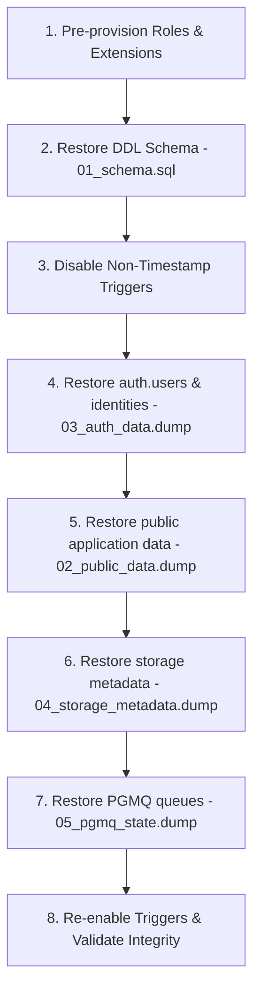

# MPN-001: PRODUCTION DATABASE BACKUP & RESTORATION RUNBOOK

**Document ID:** MPN-001-DATABASE-RUNBOOK  
**Target:** Independent PostgreSQL 16 Infrastructure  
**Source:** Supabase Cloud Project `ryitxoymayasdlabojsx`  
**Purpose:** Step-by-step production runbook for non-destructive backup, verification, schema preservation, and restoration without downtime.  

---

## 1. Overview & Architectural Scope

The ISM Prayer Network database contains critical relational data, authentication records, storage references, procedural audit triggers, and background email queue state.

### Schemas in Scope

```
+------------------+-----------------------------------------------------------------------------------------+
| Schema           | Contents & Migration Purpose                                                            |
+------------------+-----------------------------------------------------------------------------------------+
| public           | 36 application tables, views, PL/pgSQL stored procedures, and triggers                 |
| auth             | GoTrue user accounts (auth.users), bcrypt passwords, identities, and session tokens      |
| storage          | Supabase Storage metadata (buckets, objects, file path trees, ownership)               |
| pgmq             | Message queue tables, email message payloads, and dead-letter queue (DLQ) state        |
| extensions       | PostgreSQL extensions: uuid-ossp, pgcrypto, pg_net, pgmq, pg_stat_statements             |
| cron (if active) | Scheduled pg_cron database jobs for reminders and cleanup                               |
+------------------+-----------------------------------------------------------------------------------------+
```

---

## 2. Pre-Migration Prerequisites & Role Setup

When restoring onto an independently controlled PostgreSQL instance, the standard Supabase security roles must be provisioned first so that table grants, ownerships, and Row Level Security policies compile without errors.

### 2.1 Role Provisioning Script (Target Database)
Run as PostgreSQL superuser (`postgres`):

```sql
-- Create base application roles if they do not exist
DO $$
BEGIN
  IF NOT EXISTS (SELECT FROM pg_roles WHERE rolname = 'anon') THEN
    CREATE ROLE anon NOLOGIN NOINHERIT;
  END IF;
  IF NOT EXISTS (SELECT FROM pg_roles WHERE rolname = 'authenticated') THEN
    CREATE ROLE authenticated NOLOGIN NOINHERIT;
  END IF;
  IF NOT EXISTS (SELECT FROM pg_roles WHERE rolname = 'service_role') THEN
    CREATE ROLE service_role NOLOGIN NOINHERIT BYPASSRLS;
  END IF;
  IF NOT EXISTS (SELECT FROM pg_roles WHERE rolname = 'supabase_admin') THEN
    CREATE ROLE supabase_admin LOGIN SUPERUSER;
  END IF;
  IF NOT EXISTS (SELECT FROM pg_roles WHERE rolname = 'supabase_auth_admin') THEN
    CREATE ROLE supabase_auth_admin LOGIN NOINHERIT CREATEROLE;
  END IF;
  IF NOT EXISTS (SELECT FROM pg_roles WHERE rolname = 'supabase_storage_admin') THEN
    CREATE ROLE supabase_storage_admin LOGIN NOINHERIT;
  END IF;
END $$;

-- Grant role inheritance to service role and admin
GRANT anon TO postgres, service_role;
GRANT authenticated TO postgres, service_role;
GRANT service_role TO postgres;
```

### 2.2 Extension Initialization (Target Database)
```sql
CREATE SCHEMA IF NOT EXISTS extensions;
GRANT USAGE ON SCHEMA extensions TO anon, authenticated, service_role;

CREATE EXTENSION IF NOT EXISTS "uuid-ossp" SCHEMA extensions;
CREATE EXTENSION IF NOT EXISTS "pgcrypto" SCHEMA extensions;
CREATE EXTENSION IF NOT EXISTS "pg_net" SCHEMA extensions;
CREATE EXTENSION IF NOT EXISTS "pgmq" SCHEMA extensions;
```

---

## 3. Production Backup Procedures (Non-Destructive)

> [!CAUTION]
> All backup operations are strictly read-only and must be performed without altering the production database. Use direct connection strings (Port 5432) rather than connection poolers (Port 6543) to avoid transaction timeouts during large table dumps.

### 3.1 Environment Configuration
Set up connection parameters in your secure administrative terminal (replace with actual production credentials at runtime; never commit to git):

```bash
# Production Supabase Connection Settings
export SRC_DB_HOST="db.ryitxoymayasdlabojsx.supabase.co"
export SRC_DB_PORT="5432"
export SRC_DB_USER="postgres"
export SRC_DB_NAME="postgres"

# Target Independent PostgreSQL Settings
export TGT_DB_HOST="postgres.internal.ismprayernetwork.org"
export TGT_DB_PORT="5432"
export TGT_DB_USER="postgres"
export TGT_DB_NAME="ism_prayer_network"

# Backup directory timestamp
export BACKUP_DIR="./backups/$(date +%Y%m%d_%H%M%S)"
mkdir -p "$BACKUP_DIR"
```

### 3.2 Step 1: Complete Schema Extraction
Extract DDL for all schemas including functions, triggers, constraints, and RLS policies:

```bash
# Dump complete schema definition
pg_dump \
  --host="$SRC_DB_HOST" \
  --port="$SRC_DB_PORT" \
  --username="$SRC_DB_USER" \
  --dbname="$SRC_DB_NAME" \
  --schema-only \
  --quote-all-identifiers \
  --no-owner \
  --no-privileges \
  --schema="public" \
  --schema="auth" \
  --schema="storage" \
  --schema="pgmq" \
  --file="$BACKUP_DIR/01_schema.sql"
```

### 3.3 Step 2: Application Data Extraction (Public Schema)
Extract all records from the 36 public tables:

```bash
pg_dump \
  --host="$SRC_DB_HOST" \
  --port="$SRC_DB_PORT" \
  --username="$SRC_DB_USER" \
  --dbname="$SRC_DB_NAME" \
  --data-only \
  --format=custom \
  --schema="public" \
  --file="$BACKUP_DIR/02_public_data.dump"
```

### 3.4 Step 3: Authentication Data Extraction (`auth` Schema)
Extract user identities, encrypted passwords, and profile mappings:

```bash
pg_dump \
  --host="$SRC_DB_HOST" \
  --port="$SRC_DB_PORT" \
  --username="$SRC_DB_USER" \
  --dbname="$SRC_DB_NAME" \
  --data-only \
  --format=custom \
  --schema="auth" \
  --file="$BACKUP_DIR/03_auth_data.dump"
```

### 3.5 Step 4: Storage Metadata Extraction (`storage` Schema)
Extract storage bucket registry and object metadata trees:

```bash
pg_dump \
  --host="$SRC_DB_HOST" \
  --port="$SRC_DB_PORT" \
  --username="$SRC_DB_USER" \
  --dbname="$SRC_DB_NAME" \
  --data-only \
  --format=custom \
  --schema="storage" \
  --file="$BACKUP_DIR/04_storage_metadata.dump"
```

### 3.6 Step 5: Email Queue State Extraction (`pgmq` Schema)
```bash
pg_dump \
  --host="$SRC_DB_HOST" \
  --port="$SRC_DB_PORT" \
  --username="$SRC_DB_USER" \
  --dbname="$SRC_DB_NAME" \
  --data-only \
  --format=custom \
  --schema="pgmq" \
  --file="$BACKUP_DIR/05_pgmq_state.dump"
```

---

## 4. Remediation of Uncommitted Schema Elements

As discovered during the codebase audit, several database functions and records exist in production that were omitted from version control:

### 4.1 Missing PGMQ Queue Stored Procedures
Recreate the queue management routines in the target database:

```sql
-- Ensure pgmq extension is ready
CREATE EXTENSION IF NOT EXISTS "pgmq" SCHEMA extensions;

-- Function: Enqueue an email payload into the active queue
CREATE OR REPLACE FUNCTION public.enqueue_email(queue_name text, message jsonb)
RETURNS bigint
LANGUAGE plpgsql
SECURITY DEFINER
SET search_path = public, pgmq
AS $$
DECLARE
  v_msg_id bigint;
BEGIN
  SELECT pgmq.send(queue_name, message) INTO v_msg_id;
  RETURN v_msg_id;
END;
$$;

-- Function: Read batch of pending emails with visibility lock
CREATE OR REPLACE FUNCTION public.read_email_batch(queue_name text, vt_seconds integer, batch_size integer)
RETURNS TABLE (msg_id bigint, read_ct integer, enqueued_at timestamptz, vt timestamptz, message jsonb)
LANGUAGE plpgsql
SECURITY DEFINER
SET search_path = public, pgmq
AS $$
BEGIN
  RETURN QUERY SELECT * FROM pgmq.read(queue_name, vt_seconds, batch_size);
END;
$$;

-- Function: Delete successfully processed email from queue
CREATE OR REPLACE FUNCTION public.delete_email(queue_name text, message_id bigint)
RETURNS boolean
LANGUAGE plpgsql
SECURITY DEFINER
SET search_path = public, pgmq
AS $$
BEGIN
  RETURN pgmq.delete(queue_name, message_id);
END;
$$;

-- Function: Move failed email to Dead Letter Queue (DLQ)
CREATE OR REPLACE FUNCTION public.move_to_dlq(source_queue text, dlq_name text, message_id bigint, error_payload jsonb)
RETURNS bigint
LANGUAGE plpgsql
SECURITY DEFINER
SET search_path = public, pgmq
AS $$
DECLARE
  v_new_id bigint;
BEGIN
  SELECT pgmq.send(dlq_name, error_payload) INTO v_new_id;
  PERFORM pgmq.delete(source_queue, message_id);
  RETURN v_new_id;
END;
$$;
```

### 4.2 Missing Storage Bucket Record: `report-uploads`
Ensure the private reports bucket exists in `storage.buckets`:

```sql
INSERT INTO storage.buckets (id, name, public, file_size_limit, allowed_mime_types)
VALUES (
  'report-uploads',
  'report-uploads',
  false,
  15728640, -- 15MB limit
  ARRAY['application/pdf', 'application/msword', 'application/vnd.openxmlformats-officedocument.wordprocessingml.document', 'application/vnd.ms-excel', 'application/vnd.openxmlformats-officedocument.spreadsheetml.sheet', 'image/jpeg', 'image/png']
)
ON CONFLICT (id) DO UPDATE SET
  public = EXCLUDED.public,
  file_size_limit = EXCLUDED.file_size_limit;
```

---

## 5. Restoration Sequence (Target Database)

Execute restoration in strict dependency order:



### 5.1 Step-by-Step CLI Execution Commands

```bash
# 1. Apply Schema DDL
psql --host="$TGT_DB_HOST" --port="$TGT_DB_PORT" --username="$TGT_DB_USER" --dbname="$TGT_DB_NAME" \
  --file="$BACKUP_DIR/01_schema.sql"

# 2. Disable activity log trigger temporarily to avoid recording the restore as user edits
psql --host="$TGT_DB_HOST" --port="$TGT_DB_PORT" --username="$TGT_DB_USER" --dbname="$TGT_DB_NAME" \
  -c "SET session_replication_role = 'replica';"

# 3. Restore Auth Schema (Users and Passwords)
pg_restore \
  --host="$TGT_DB_HOST" \
  --port="$TGT_DB_PORT" \
  --username="$TGT_DB_USER" \
  --dbname="$TGT_DB_NAME" \
  --data-only \
  --schema="auth" \
  "$BACKUP_DIR/03_auth_data.dump"

# 4. Restore Public Application Data
pg_restore \
  --host="$TGT_DB_HOST" \
  --port="$TGT_DB_PORT" \
  --username="$TGT_DB_USER" \
  --dbname="$TGT_DB_NAME" \
  --data-only \
  --schema="public" \
  "$BACKUP_DIR/02_public_data.dump"

# 5. Restore Storage Metadata
pg_restore \
  --host="$TGT_DB_HOST" \
  --port="$TGT_DB_PORT" \
  --username="$TGT_DB_USER" \
  --dbname="$TGT_DB_NAME" \
  --data-only \
  --schema="storage" \
  "$BACKUP_DIR/04_storage_metadata.dump"

# 6. Restore PGMQ Queue State
pg_restore \
  --host="$TGT_DB_HOST" \
  --port="$TGT_DB_PORT" \
  --username="$TGT_DB_USER" \
  --dbname="$TGT_DB_NAME" \
  --data-only \
  --schema="pgmq" \
  "$BACKUP_DIR/05_pgmq_state.dump"

# 7. Re-enable standard trigger execution
psql --host="$TGT_DB_HOST" --port="$TGT_DB_PORT" --username="$TGT_DB_USER" --dbname="$TGT_DB_NAME" \
  -c "SET session_replication_role = 'origin';"
```

---

## 6. Post-Restoration Verification & Integrity Checklist

Run this automated validation script against the restored database to confirm complete parity:

```sql
DO $$
DECLARE
  v_table text;
  v_src_count bigint;
  v_tgt_count bigint;
  v_failed boolean := false;
  v_tables text[] := ARRAY[
    'profiles', 'books', 'categories', 'combo_packs', 'combo_pack_items',
    'contacts', 'contact_messages', 'newsletter_subscribers', 'events',
    'birthday_wishes', 'programs', 'program_dispatches', 'program_engagements',
    'prayer_requests', 'prayer_interactions', 'prayer_groups', 'group_members',
    'group_call_participations', 'group_prayer_assignments', 'prayer_room_sessions',
    'prayer_room_participants', 'prayer_slots', 'prayer_points', 'prayer_weeks',
    'prayer_reports', 'announcements', 'campaigns', 'testimonies', 'purchase_orders',
    'purchases', 'site_settings', 'activity_logs', 'email_send_log', 'suppressed_emails'
  ];
BEGIN
  RAISE NOTICE '==================================================';
  RAISE NOTICE 'STARTING DATABASE RESTORATION PARITY CHECK';
  RAISE NOTICE '==================================================';

  -- Verify auth schema
  SELECT count(*) INTO v_tgt_count FROM auth.users;
  RAISE NOTICE 'auth.users restored count: %', v_tgt_count;

  -- Verify RLS is enabled on all public tables
  FOR v_table IN
    SELECT tablename FROM pg_tables WHERE schemaname = 'public'
  LOOP
    IF NOT EXISTS (
      SELECT 1 FROM pg_class c
      JOIN pg_namespace n ON n.oid = c.relnamespace
      WHERE n.nspname = 'public' AND c.relname = v_table AND c.relrowsecurity = true
    ) THEN
      RAISE WARNING 'SECURITY DEFECT: RLS is NOT enabled on table public.%', v_table;
      v_failed := true;
    END IF;
  END LOOP;

  -- Verify triggers
  IF NOT EXISTS (SELECT 1 FROM pg_trigger WHERE tgname = 'on_auth_user_created') THEN
    RAISE WARNING 'MISSING TRIGGER: on_auth_user_created is missing on auth.users';
    v_failed := true;
  END IF;

  IF NOT EXISTS (SELECT 1 FROM pg_trigger WHERE tgname = 'trg_validate_prayer_request_status') THEN
    RAISE WARNING 'MISSING TRIGGER: trg_validate_prayer_request_status is missing on prayer_requests';
    v_failed := true;
  END IF;

  IF v_failed THEN
    RAISE EXCEPTION 'Restoration verification FAILED. Investigate warnings above.';
  ELSE
    RAISE NOTICE 'SUCCESS: All tables, users, triggers, and RLS policies verified.';
  END IF;
END $$;
```

