# MPN-001: SECURITY AUDIT, CREDENTIAL CONTINUITY & HARDENING

**Project:** ISM Prayer Network Platform Migration  
**Document ID:** MPN-001-SECURITY  
**Compliance Requirement:** Zero Exposure of Plaintext Secrets; Full Identity & Credential Continuity  

---

## 1. Audit of the Administrative PIN Mechanism & Secure Replacement

The platform currently implements an administrative PIN gate (`ADMIN_PIN`) designed to provide coordinators with fast access to administrative dashboards without standard user authentication.

```mermaid
flowchart TD
    subgraph CurrentVulnerable [Current Vulnerable Architecture]
        Client1[Browser: /api/dashboard] -->|Submits 4-digit PIN in plain JSON| Gate1[BookstorePinGate.tsx]
        Gate1 -->|Invokes with PIN: 2323| Func1[Edge Function: dashboard-admin]
        Func1 -->|Compares body.pin === ADMIN_PIN| ServiceRole1[Bypasses all RLS with Service Role Key]
        ServiceRole1 -->|Full CRUD on 24 Tables| DB1[(PostgreSQL Database)]
    end

    subgraph ProposedSecure [Proposed Secure Architecture]
        Client2[Browser: /admin or /api/dashboard] -->|Cloudflare Access Zero Trust Gate| CF_Access[Cloudflare Access / SSO]
        CF_Access -->|Admin Email OTP / WebAuthn| CF_AuthWorker[Auth Worker Gateway]
        CF_AuthWorker -->|Issues Encrypted HttpOnly JWT Cookie| Client2
        Client2 -->|HttpOnly Cookie + Admin Claims| WorkerAPI[Cloudflare Worker API]
        WorkerAPI -->|Queries with Scoped Role + Audit Actor ID| DB2[(PostgreSQL Database)]
    end
```



### 1.1 Vulnerability Analysis of the Current PIN Mechanism
1. **Critical Brute-Force Vulnerability:**
   - A 4-digit numeric PIN possesses only $10^4 = 10,000$ possible combinations (0000 to 9999).
   - In the current implementation, neither the frontend nor the Edge Function (`dashboard-admin`) enforces rate limiting or IP throttling. An automated script can exhaust all 10,000 combinations in less than 2 minutes.
2. **Hardcoded Credential in Frontend Code & Git History:**
   - As identified during this audit, the value `"2323"` was explicitly hardcoded into `src/pages/PublicDashboard.tsx` (line 56) and committed to the Git repository in commit `37c94de`, remaining present in current production code.
   - Even though commit `a6d55d0` introduced server-side validation against `ADMIN_PIN`, `PublicDashboard.tsx` continues to pass the hardcoded fallback `"2323"` on unlock.
3. **Overprivileged Service Role Execution:**
   - The PIN endpoint executes all database queries and mutations using `SUPABASE_SERVICE_ROLE_KEY`. This completely bypasses PostgreSQL Row Level Security (RLS) across 24 core tables, including `profiles`, `contacts`, `purchases`, and `purchase_orders`.
4. **Anonymized Audit Trail:**
   - Because mutations execute via the service role key outside an authenticated user session, PostgreSQL evaluates `auth.uid()` as `NULL`.
   - In `public.activity_logs`, records created via the PIN dashboard lack actor attribution (`actor_id` is null, `actor_email` is null), rendering the audit log ineffective for regulatory or incident forensics.
5. **Shared Credential / Zero Revocability:**
   - All coordinators and bookstore managers share the exact same PIN. If an individual leaves the team, the PIN must be rotated across the entire organization, disrupting all active administrator workflows.

### 1.2 Proposed Secure Replacement: The Fast-Access Admin Session System
To maintain the rapid, low-friction access that ministry administrators currently rely on while establishing enterprise-grade security:

#### Step 1: Perimeter Protection with Cloudflare Access (Zero Trust)
- Protect routes `/api/dashboard`, `/api/bookstore`, and `/admin` using **Cloudflare Access**.
- Instead of remembering passwords or PINs, administrators enter their registered ministry email (e.g. `@ismprayernetwork.org`). Cloudflare instantly emails a one-time 6-digit PIN code (or allows 1-click biometric WebAuthn / TouchID login).
- Cloudflare verifies the user at the edge network before requests ever reach the application code or database.

#### Step 2: Cryptographic HttpOnly Session Cookies
- Upon verification, the auth gateway issues an encrypted, `HttpOnly`, `SameSite=Lax`, `Secure` JWT cookie signed with an internal HMAC-SHA256 secret.
- The cookie contains the administrator's verified identity (`email`, `user_id`, `role: 'admin'`).
- The client-side code never touches the raw secret, completely eliminating exposure via `sessionStorage` or browser scripts.

#### Step 3: Rate Limiting & Brute-Force Shielding
- At the Cloudflare Worker layer, enforce a strict rate limit: maximum 5 failed attempts per IP address per 15 minutes, followed by an exponential backoff lockout.

#### Step 4: Individualized Audit Logging
- Every mutation executed through the admin interface passes the administrator's authenticated email and ID down to PostgreSQL:
  ```sql
  SET LOCAL request.jwt.claim.sub = 'admin-user-uuid';
  SET LOCAL request.jwt.claim.email = 'pastor@ismprayernetwork.org';
  ```
- The `log_activity()` trigger records the exact identity of the administrator who made each change in `public.activity_logs`.

---

## 2. User Authentication Continuity (Zero Password Resets)

A primary risk in database migration is disrupting users by invalidating their credentials or requiring widespread password resets. The ISM Prayer Network user base can be transitioned with **100% credential continuity**.

### 2.1 Password Hash Compatibility (Bcrypt Standard)
- Supabase GoTrue stores user passwords in the `auth.users` table under the column `encrypted_password`.
- The hashing algorithm utilized is standard **bcrypt** (identifiable by the `$2a$` or `$2b$` prefix, followed by the cost factor, typically `10` or `12`, and the 53-character salt/hash string).
- **Continuity Guarantee:** Because bcrypt is an open, universally standardized cryptographic format, any standard bcrypt implementation (such as native GoTrue, Go bcrypt, Node `bcryptjs`, Python `bcrypt`, or WebAssembly-compiled bcrypt in Cloudflare Workers) can verify these existing hashes directly.
- Users can log into the migrated platform using their existing email and password on Day 1 without ever being prompted to reset their password.

### 2.2 Relational Integrity & User UUID Preservation
- User identity is anchored to the PostgreSQL `auth.users.id` UUID primary key.
- Eleven public tables maintain foreign key relationships referencing `auth.users(id)`:
  1. `profiles.user_id`
  2. `prayer_groups.created_by`
  3. `group_members.user_id`
  4. `prayer_requests.user_id`
  5. `prayer_interactions.user_id`
  6. `prayer_slots.user_id`
  7. `prayer_room_sessions.owner_id`
  8. `group_call_participations.user_id`
  9. `prayer_reports.user_id`
  10. `purchase_orders.user_id`
  11. `purchases.user_id`
- Furthermore, private storage paths in `pop-uploads` and `report-uploads` are organized by user UUID folder prefixes: `${user.id}/${Date.now()}.${ext}`.
- **Runbook Requirement:** The database restoration must dump and restore the `auth.users` table verbatim, preserving all original UUID primary keys. Generating new UUIDs for existing users is strictly prohibited as it would detach all historical purchases, prayer records, and uploaded receipts.

### 2.3 Session & Token Transition Strategy
- Active client sessions stored in browser `localStorage` hold a short-lived access token (1 hour) and a refresh token.
- When the frontend cutover occurs:
  - If retaining the Supabase GoTrue auth service (Approach B), valid refresh tokens will seamlessly exchange for new access tokens on the new host domain without requiring the user to re-enter credentials.
  - If transitioning to a custom Cloudflare Workers auth handler (Approach A), existing sessions will gracefully expire, prompting users to perform a single seamless login using their existing credentials, which will then issue new secure cookies.

---

## 3. Git History Security & Sensitive Configuration Audit

In compliance with strict security guidelines, all occurrences of committed configuration and credentials across the repository's Git history were audited. **Only filenames, commit identifiers, and credential classifications are documented below; no secret values are exposed.**

### 3.1 Inventory of Sensitive Findings in Git History

| Finding # | File Location | Commit ID(s) | Credential / Secret Classification | Remediation Required |
| :- | :--- | :--- | :--- | :--- |
| **SEC-01** | `.env` | `0495cf0`, `f53411a` | Supabase Project URL & Public Anonymous API Key | Remove `.env` from Git tracking; ensure `.gitignore` covers `.env*`. Rotate anonymous keys upon target deployment. |
| **SEC-02** | `src/pages/PublicDashboard.tsx` | `37c94de`, `Current HEAD` | Plaintext Administrative PIN (Hardcoded in client script) | Replace with Cloudflare Access or authenticated session token. Purge hardcoded string. |
| **SEC-03** | `src/components/dashboard/BookstorePinGate.tsx` | `372e385`, `a6d55d0` | Plaintext Administrative PIN (Committed in earlier revision) | Rotate `ADMIN_PIN` value on production backend; sanitize Git commit history. |
| **SEC-04** | Git Commit Messages | `372e385`, `a6d55d0` | Plaintext Administrative PIN in Commit Message Text | Sanitize commit log history using `git-filter-repo` or BFG Repo-Cleaner prior to publishing repo. |
| **SEC-05** | `src/pages/ApiKeyDocument.tsx` | `4085bd2`, `a6229a0` | Static Partner API Key string embedded in UI component | Move partner API key generation to an authenticated admin database query; remove static key from JSX. |
| **SEC-06** | `drizzle.config.ts` | `Current HEAD` | Database Migration Connection URL Environment Variable Reference | Confirm `LOVABLE_DB_MIGRATION_URL` is never hardcoded in repository files; provide only via CI/CD secrets. |
| **SEC-07** | `supabase/migrations/20260222103219_...sql` | `Current HEAD` | Personal Administrator Email Address hardcoded in PL/pgSQL bootstrap trigger | Parameterize bootstrap super-admin creation or manage roles via environment variables. |
| **SEC-08** | `drizzle/migrations/0000_migration.sql` & `supabase/migrations/20260810134528_...sql` | `Current HEAD` | Hardcoded Supabase Project URL in `net.http_post` trigger | Replace hardcoded URLs with database settings lookup (`site_settings`) or environment configuration. |
| **SEC-09** | `src/components/bookstore/CheckoutModal.tsx` | `Current HEAD` | Merchant Billing & Settlement Codes (KingsPay and ESPEES) | Move merchant payment codes to database table `site_settings` for dynamic administrative management. |
| **SEC-10** | `index.html` | `Current HEAD` | Google Cloud Storage Signed URL with GoogleAccessId and Signature | Replace third-party signed URLs with static relative assets hosted on Cloudflare Pages (`/og-image.png`). |

---

## 4. Storage Security & Presigned URL Architecture

The migration from Supabase Storage to Cloudflare R2 must maintain identical access controls for both public assets and confidential financial/pastoral records.

```
+------------------+-------------------+---------------------------------------------+-------------------------------------------------------------+
| Bucket Name      | Target Service    | Exposure Level                              | Access Authorization & Expiry Rules                         |
+------------------+-------------------+---------------------------------------------+-------------------------------------------------------------+
| book-covers      | Cloudflare R2     | Public Read                                 | Accessible via public CDN URL. Write restricted to admins.   |
| pop-uploads      | Cloudflare R2     | Strict Private (Signed URLs Only)           | Read via short-lived AWS S3 presigned URLs (600s).          |
|                  |                   |                                             | Upload scoped to user's folder: ${auth.uid()}/*            |
| report-uploads   | Cloudflare R2     | Strict Private (Signed URLs Only)           | Read via signed URLs (3600s) restricted to owner & admins. |
|                  |                   |                                             | Upload scoped to user's folder: ${auth.uid()}/*            |
+------------------+-------------------+---------------------------------------------+-------------------------------------------------------------+
```

### 4.1 Presigned URL Implementation in Cloudflare Workers
Private bucket access is handled via the AWS S3 SDK inside a Cloudflare Worker:

```typescript
import { S3Client, GetObjectCommand, PutObjectCommand } from "@aws-sdk/client-s3";
import { getSignedUrl } from "@aws-sdk/s3-request-presigner";

const r2 = new S3Client({
  region: "auto",
  endpoint: `https://${env.CF_ACCOUNT_ID}.r2.cloudflarestorage.com`,
  credentials: {
    accessKeyId: env.R2_ACCESS_KEY_ID,
    secretAccessKey: env.R2_SECRET_ACCESS_KEY,
  },
});

// Mint short-lived download URL (10 minutes for payment proofs, 60 minutes for reports)
export async function createDownloadUrl(bucket: string, key: string, expiresInSeconds: number): Promise<string> {
  const command = new GetObjectCommand({ Bucket: bucket, Key: key });
  return getSignedUrl(r2, command, { expiresIn: expiresInSeconds });
}

// Mint short-lived upload URL restricted to authenticated user's folder
export async function createUploadUrl(bucket: string, userId: string, filename: string): Promise<string> {
  const key = `${userId}/${Date.now()}-${filename}`;
  const command = new PutObjectCommand({ Bucket: bucket, Key: key });
  return getSignedUrl(r2, command, { expiresIn: 300 }); // 5 minute upload window
}
```

