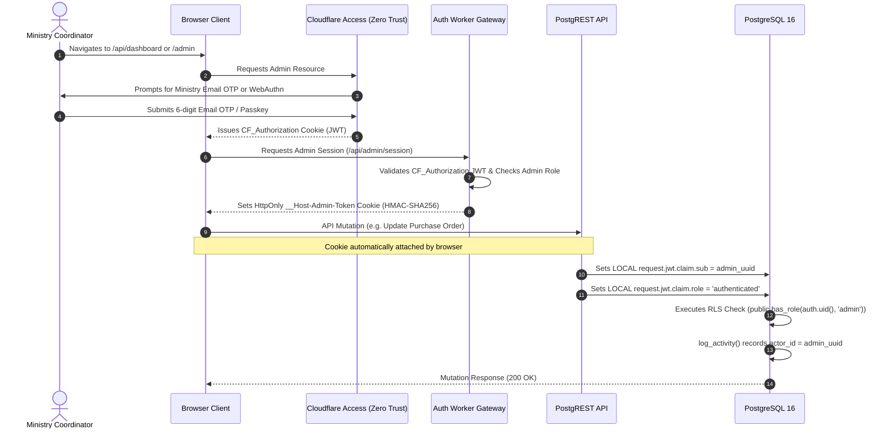
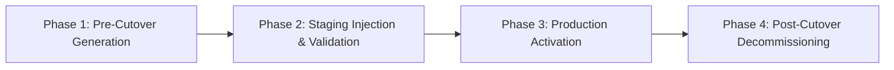

# MPN-002: SECURITY REMEDIATION, ACCESS CONTROL & CREDENTIAL ROTATION

**Project:** ISM Prayer Network Platform Migration  
**Milestone:** MPN-002: Infrastructure Readiness  
**Document ID:** MPN-002-SECURITY-REMEDIATION  
**Compliance Standard:** Zero Exposure of Plaintext Secrets; Zero-Trust Administrative Security; Defense-in-Depth Architecture  

---

## 1. Executive Summary & Remediation Objectives

During the architectural and security audits conducted in `ISM-MIGRATION-AUDIT.md` and `MPN-001-SECURITY.md`, multiple critical security vulnerabilities and architectural design flaws were identified in the legacy platform. These vulnerabilities stem primarily from:
1. A hardcoded, shared four-digit administrative PIN gate bypassing database Row Level Security (RLS).
2. The complete absence of rate limiting and brute-force protection on administrative endpoints.
3. The loss of audit trail non-repudiation caused by service role execution without actor attribution.
4. Historical and current credential exposure across client code, Git history, and project configuration.
5. Inconsistent storage access control patterns between upload workflows and administrative review.

This document establishes the production security architecture for the target self-hosted PostgreSQL, PostgREST, GoTrue, and Cloudflare environment. It defines the replacement access control architecture, provides an audited credential exposure catalog, establishes a multi-phase credential rotation runbook, and defines storage bucket access security.

```mermaid
flowchart TD
    subgraph LegacyThreatModel [Legacy Vulnerable Access Model]
        Attacker[Public Internet / Automated Bot] -->|Brute force 10,000 PIN combinations| EdgeGate[Edge Function: dashboard-admin]
        ClientPIN[Browser / PublicDashboard.tsx] -->|Hardcoded PIN '2323' in code| EdgeGate
        EdgeGate -->|Validates static string| ServiceRole[SUPABASE_SERVICE_ROLE_KEY]
        ServiceRole -->|Bypasses RLS on 24 tables| LegacyDB[(PostgreSQL)]
        LegacyDB -->|Audit logs record NULL actor| AuditNull[activity_logs: actor_id = NULL]
    end

    subgraph TargetSecureModel [Target Zero-Trust Access Model]
        AdminUser[Ministry Administrator] -->|Accesses /admin or /api/dashboard| CFAccess[Cloudflare Zero Trust / Access Edge]
        CFAccess -->|Email OTP / FIDO2 WebAuthn / Passkey| IdentityVerif{Verified Identity?}
        IdentityVerif -->|No| BlockEdge[Blocked at Edge Network]
        IdentityVerif -->|Yes: Admin Domain Allowlist| AuthWorker[Cloudflare Auth Worker Gateway]
        AuthWorker -->|Generates Signed HttpOnly SameSite Cookie| AdminSession[Secure Admin Session]
        AdminSession -->|Request + Scoped JWT with Sub Claim| PostgREST[PostgREST / API Layer]
        PostgREST -->|Evaluates RLS via authenticated role| SecureDB[(PostgreSQL 16)]
        SecureDB -->|Audit trigger captures actor UUID & email| AuditPreserved[activity_logs: actor_id = admin_uuid]
    end
```



---

## 2. Administrative Access Control Remediation

### 2.1 Forensic Audit of the Legacy PIN Mechanism

The platform currently implements an administrative PIN gate intended to provide bookstore coordinators and ministry staff with rapid access to administrative tools without forcing full account logins. A comprehensive codebase inspection reveals the following implementation details:

#### 1. Frontend Implementation
- **Hardcoded Fallback in Production Page:** In [src/pages/PublicDashboard.tsx](file:///c:/Users/user/Documents/ismprayernetwork/src/pages/PublicDashboard.tsx#L53-L60), the component mounts `BookstorePinGate` and explicitly executes:
  ```typescript
  // src/pages/PublicDashboard.tsx (lines 53-59)
  <BookstorePinGate
    onUnlock={() => {
      sessionStorage.setItem("dashboard_unlocked", "1");
      storePin("2323", "dashboard_pin");
      setUnlocked(true);
    }}
    title="Admin Dashboard"
  />
  ```
- **Plaintext In-Memory Persistence:** In [src/hooks/useBookstoreAdmin.ts](file:///c:/Users/user/Documents/ismprayernetwork/src/hooks/useBookstoreAdmin.ts#L6-L13), the PIN is stored directly in browser `sessionStorage` under keys `dashboard_pin` and `bookstore_pin`. Any client-side script or cross-site scripting (XSS) payload can instantly read the administrative credential via `sessionStorage.getItem('dashboard_pin')`.
- **Client-Side Administrative ORM:** In `src/hooks/useBookstoreAdmin.ts`, helper methods `adminQuery`, `adminInsert`, `adminUpdate`, and `adminDelete` proxy raw database queries to the backend edge function, passing the stored PIN alongside arbitrary SQL table names, filter arrays, and mutation payloads.

#### 2. Backend Edge Function Implementation
- In [supabase/functions/dashboard-admin/index.ts](file:///c:/Users/user/Documents/ismprayernetwork/supabase/functions/dashboard-admin/index.ts#L22-L37), incoming requests are inspected for `body.pin`:
  ```typescript
  // supabase/functions/dashboard-admin/index.ts (lines 22-28)
  const VALID_PIN = Deno.env.get("ADMIN_PIN");
  if (!VALID_PIN || pin !== VALID_PIN) {
    return new Response(JSON.stringify({ error: "Invalid PIN" }), {
      status: 403,
      headers: { ...corsHeaders, "Content-Type": "application/json" },
    });
  }
  ```
- If the string matches `Deno.env.get("ADMIN_PIN")`, the function instantiates the Supabase client using `SUPABASE_SERVICE_ROLE_KEY`.
- The function grants full read, write, update, and delete access across 24 core application tables:
  `books`, `categories`, `profiles`, `testimonies`, `programs`, `events`, `contact_messages`, `newsletter_subscribers`, `prayer_requests`, `prayer_groups`, `purchase_orders`, `purchases`, `site_settings`, `combo_packs`, `combo_pack_items`, `campaigns`, `contacts`, `announcements`, `prayer_reports`, `prayer_points`, `group_prayer_assignments`, `group_call_participations`, `group_members`, and `prayer_weeks`.

#### 3. Mathematical Attack Surface & Vulnerability Assessment
1. **Trivial Brute-Force Exhaustion:** A 4-digit numeric code represents an entropy space of only $10^4 = 10,000$ possible combinations (`0000` to `9999`). With no edge rate limiting, an attacker sending 100 requests per second can exhaust the entire keyspace in **1 minute and 40 seconds**.
2. **Total RLS Bypass:** Because requests execute via the service role key, all PostgreSQL Row Level Security policies are ignored.
3. **Audit Log Anonymization:** Because requests are not bound to an authenticated PostgreSQL user (`auth.uid()` evaluates to `NULL`), activity logs generated by `public.log_activity()` have `actor_id = NULL` and `actor_email = NULL`. It is impossible to determine which coordinator created, updated, or deleted sensitive records, violating data accountability standards.
4. **Shared Secret Revocation Failure:** Because every administrator shares the same PIN, revoking access for a departing staff member requires changing the PIN for all administrators, causing coordination bottlenecks and operational downtime.

---

### 2.2 Target Architecture: Individualized Zero-Trust Administrator Access

To eliminate the security risks of the shared PIN while preserving the low-friction operational workflow required by bookstore managers and ministry coordinators, the platform will implement a **Zero-Trust Identity Gateway**.



#### Step 1: Edge Perimeter Protection via Cloudflare Access (Zero Trust)
- Routes `/api/dashboard`, `/api/bookstore`, and `/admin/*` are secured behind **Cloudflare Access**.
- **Access Policy:**
  - Allowed Identity Providers: One-Time PIN (OTP) to authorized domain emails (`*@ismprayernetwork.org`) or designated administrator emails.
  - Optional FIDO2 / WebAuthn hardware keys (TouchID, Windows Hello, YubiKey) for instant 1-click biometric sign-in.
  - Zero application code exposure: Unauthenticated requests from the public internet are challenged and dropped at Cloudflare's edge data centers before ever reaching the origin server or database.

#### Step 2: Cryptographic HttpOnly Session Management
- Upon successful authentication through Cloudflare Access, the request reaches the Cloudflare Auth Worker.
- The Auth Worker resolves the administrator's identity against `auth.users` and verifies administrative privileges via `public.user_roles` (`role = 'admin'`).
- The worker sets an encrypted, scoped session cookie:
  - **Cookie Name:** `__Host-Admin-Token`
  - **Flags:** `HttpOnly; Secure; SameSite=Strict; Path=/; Max-Age=28800` (8-hour working shift expiry).
  - **Payload:** Short-lived JWT containing:
    ```json
    {
      "sub": "b2f67a21-9d41-4cb3-9118-a6d1b28e4091",
      "email": "coordinator@ismprayernetwork.org",
      "role": "authenticated",
      "app_metadata": { "roles": ["admin"] },
      "exp": 1729814400
    }
    ```
- **Security Guarantee:** The raw token cannot be read, stolen, or manipulated by client-side JavaScript, eliminating all XSS credential-theft vectors.

#### Step 3: Server-Side Rate Limiting & Brute-Force Shielding
- At the Cloudflare Worker gateway, a strict rate limiter is enforced:
  - Maximum **5 failed authentication attempts** per IP address per 15-minute window.
  - Sixth failed attempt triggers an automatic **60-minute IP block** and logs a security alert.
  - Legitimate administrators authenticate seamlessly via magic link / OTP without password guessing.

#### Step 4: Audit Attribution & Row Level Security Enforcement
- Every query routed to PostgREST carries the administrator's authenticated claims. PostgREST executes:
  ```sql
  SET LOCAL request.jwt.claim.sub = 'b2f67a21-9d41-4cb3-9118-a6d1b28e4091';
  SET LOCAL request.jwt.claim.email = 'coordinator@ismprayernetwork.org';
  SET LOCAL request.jwt.claim.role = 'authenticated';
  ```
- PostgreSQL evaluates standard Row Level Security:
  ```sql
  CREATE POLICY "Admins have full access to purchase orders"
  ON public.purchase_orders
  FOR ALL
  TO authenticated
  USING (public.has_role(auth.uid(), 'admin'))
  WITH CHECK (public.has_role(auth.uid(), 'admin'));
  ```
- The existing trigger `public.log_activity()` captures the administrator's identity:
  ```sql
  -- In public.log_activity() trigger:
  NEW.actor_id := auth.uid();
  NEW.actor_email := auth.jwt() ->> 'email';
  ```
  Every record update, book price modification, and order approval is permanently and incontrovertibly linked to the specific staff member who performed it.

#### Step 5: Coordinator Workflow Transition
To ensure zero operational friction for non-technical bookstore coordinators:
1. Coordinators do not need to memorize a 20-character password.
2. When navigating to `/api/bookstore`, they enter their work email.
3. They receive a 6-digit login code in their email inbox (valid for 10 minutes) and enter it once.
4. The dashboard unlocks immediately with full administrative capabilities for the duration of their session.

---

## 3. Exposed Credentials Inventory & Git History Audit

> [!WARNING]
> **COMPLIANCE MANDATE:** In accordance with migration safety instructions, the table below catalogs credential types, filenames, and exposure scopes. **Zero plaintext secrets or token values are printed.**

### 3.1 Repository Exposure Catalog

| Reference Location | Credential / Secret Type | Exposure Scope | Risk Severity | Required Remediation Action |
| :--- | :--- | :--- | :--- | :--- |
| `src/pages/PublicDashboard.tsx` (L56) | Shared Administrative PIN (`storePin("...")`) | Client-side source bundle & Git history | **CRITICAL** | Remove hardcoded string; replace with Cloudflare Zero Trust session check. |
| Git commit `37c94de` | Hardcoded Admin PIN | Git commit history | **CRITICAL** | Rotate PIN immediately; rewrite history or invalidate upon cutover. |
| Git commit `cece3a7` | Admin PIN edge logic & configuration | Git commit history | **HIGH** | Invalidate legacy PIN; transition backend to JWT role checks. |
| `.env` / Project Root | Supabase Project URL (`https://*.supabase.co`) | Local repository environment | **MEDIUM** | Replace with independent API domain (`https://api.ismprayernetwork.org`). |
| `.env` / Project Root | Supabase Public Anon Key (`eyJ...`) | Client build bundle | **MEDIUM** | Rotate anon key; sign with new independent HMAC-SHA256 `JWT_SECRET`. |
| `src/integrations/supabase/client.ts` | Fallback Supabase Project URL & Anon Key | Client build bundle | **MEDIUM** | Restrict to public anon scope; bind to production environment variables. |
| `supabase/functions/daily-room/index.ts` | Daily.co API Secret Token reference | Edge Function runtime secret | **HIGH** | Rotate Daily.co API key in Daily.co dashboard; store only in Worker secrets. |
| `supabase/functions/dashboard-admin/index.ts` | Supabase Service Role Key reference | Edge Function runtime secret | **CRITICAL** | Decommission edge function; replace with scoped PostgREST role policies. |
| `supabase/functions/send-email/index.ts` | Resend / SMTP API Key reference | Edge Function runtime secret | **HIGH** | Rotate transactional email key; store in Cloudflare Worker secret store. |
| Git commit `81346a8` | Internal admin API key reference & guide | Git commit history | **MEDIUM** | Ensure referenced keys are fully revoked in production provider dashboards. |

---

## 4. Step-by-Step Credential Rotation Plan

To eliminate legacy exposure without service interruption, credential rotation will follow a four-phase lifecycle:



### 4.1 Phase 1: Pre-Cutover Secret Generation (Air-Gapped / Offline)
Generate new, cryptographically high-entropy secrets for all components using standard operating system entropy sources (`/dev/urandom`):

1. **PostgreSQL Database Master Password:**
   ```bash
   # Generate 32-byte alphanumeric database password (256-bit entropy)
   openssl rand -base64 32 | tr -dc 'a-zA-Z0-9' | head -c 32
   ```
2. **Unified HMAC-SHA256 JWT Secret:**
   - GoTrue, PostgREST, Supabase Realtime, and Cloudflare Workers must share the exact same JWT secret to validate user sessions without network roundtrips.
   ```bash
   # Generate 64-byte hex JWT Secret (512-bit entropy)
   openssl rand -hex 64
   ```
3. **Derived Anon Key & Service Role Key:**
   - Using the new `JWT_SECRET`, generate fresh HS256 JWTs:
     - **Anon Key Payload:** `{"role": "anon", "iss": "supabase", "iat": 1729800000, "exp": 2045160000}`
     - **Service Role Key Payload:** `{"role": "service_role", "iss": "supabase", "iat": 1729800000, "exp": 2045160000}`
4. **Cloudflare Worker API Secret & Encryption Salt:**
   ```bash
   openssl rand -hex 32
   ```
5. **Daily.co Video Token:**
   - In Daily.co Dashboard -> Developer Settings -> Create New API Key (label: `ism-prod-vps-2026`).

### 4.2 Phase 2: Staging Injection & Component Verification
1. Store all generated secrets in an encrypted password manager or secure vault.
2. Inject secrets into the staging environment:
   - On the VPS: Create `/opt/ism-backend/.env` with file permissions restricted to root only (`chmod 600 /opt/ism-backend/.env`).
   - On Cloudflare: Add secrets via `wrangler secret put <KEY_NAME>`:
     - `wrangler secret put JWT_SECRET`
     - `wrangler secret put DAILY_API_KEY`
     - `wrangler secret put SMTP_API_KEY`
     - `wrangler secret put DB_CONNECTION_STRING`
3. Verify signature alignment: Confirm that a JWT minted by GoTrue is accepted without error by PostgREST and Realtime.

### 4.3 Phase 3: Production Activation
1. Perform cutover as scheduled in `MPN-001-CUTOVER-PLAN.md`.
2. Deploy the Cloudflare Pages frontend configured with:
   - `VITE_SUPABASE_URL = https://api.ismprayernetwork.org`
   - `VITE_SUPABASE_ANON_KEY = <Newly Generated Anon JWT>`
3. Activate the Cloudflare Access Zero Trust application protecting `/api/dashboard`, `/api/bookstore`, and `/admin`.

### 4.4 Phase 4: Post-Cutover Decommissioning & Revocation
Within 24 hours of successful cutover:
1. **Revoke Old Supabase Keys:** In the legacy Supabase project settings (`ryitxoymayasdlabojsx`), generate a new project API key or pause the project to instantly invalidate all legacy anon and service role keys.
2. **Revoke Legacy Daily.co Keys:** Delete the old Daily.co API key used during Lovable development.
3. **Revoke Old Email Service Keys:** Rotate API tokens in Resend / AWS SES and verify no traffic hits the old credentials.
4. **Git History Scrubbing:** Execute an automated repository scrub using `git-filter-repo` to permanently purge historical commits containing the hardcoded PIN string `"2323"`, followed by a force-push to protected branches.

---

## 5. Storage Access Controls & API Compatibility Remediation

### 5.1 Bucket Inventory & Security Policies

The application utilizes three distinct storage buckets. The table below outlines their current state, security risk, and the target configuration:

| Bucket Identifier | Purpose & Data Sensitivity | Current Access Model | Target Access Model | Enforced TTL / Rules |
| :--- | :--- | :--- | :--- | :--- |
| `book-covers` | Bookstore catalog cover images (Public assets) | Public read; Admin upload | **Public CDN Cached** | Cache-Control: `public, max-age=604800` (7 days); Upload restricted to authenticated admins. |
| `pop-uploads` | Proof of Payment bank receipts (Contains donor names, bank account slips, monetary sums) — **HIGH SENSITIVITY** | Inconsistent: Uploads use `getPublicUrl` in `CheckoutModal.tsx`, but `createSignedUrl` in `OrdersManager.tsx` | **Strictly Private Read** | Public access disabled (`public = false`). Read allowed **only** via signed URL with **600-second (10-minute) TTL**. Write allowed to authenticated users and guest checkout with UUID file naming. |
| `report-uploads` | Missionary and coordinator prayer reports, field photos, attendance sheets — **CONFIDENTIAL** | Private read via `createSignedUrl(3600)` | **Strictly Private Read** | Public access disabled (`public = false`). Read allowed **only** via signed URL with **3600-second (1-hour) TTL**. Write restricted to user UUID path prefix `${auth.uid()}/...`. |

### 5.2 Storage Security Defect Remediation: `CheckoutModal.tsx`

In [src/components/bookstore/CheckoutModal.tsx](file:///c:/Users/user/Documents/ismprayernetwork/src/components/bookstore/CheckoutModal.tsx#L160-L163), the current code performs:
```typescript
// Legacy vulnerable pattern:
const { error: uploadErr } = await supabase.storage.from("pop-uploads").upload(path, popFile);
const { data: { publicUrl } } = supabase.storage.from("pop-uploads").getPublicUrl(path);
```
- **Vulnerability:** If the `pop-uploads` bucket were made public in storage settings, any bank slip uploaded by a donor would be indexable and publicly accessible via predictable URLs.
- **Remediation:** Proof of payment receipts must **never** generate or store a `publicUrl`. Instead, the application must store only the canonical object `path` (e.g. `${order_id}/${filename}`) in `purchase_orders.payment_proof_path`. When an administrator views the order in `OrdersManager.tsx`, the system calls `createSignedUrl(path, 600)`, guaranteeing that access expires in 10 minutes and requires valid admin authentication.

### 5.3 Supabase Storage API Compatibility Architecture

The frontend client utilizes `@supabase/storage-js` methods (`.upload()`, `.getPublicUrl()`, `.createSignedUrl()`). To preserve 100% frontend code compatibility without rewriting component storage hooks, the target backend offers two validated paths:

```mermaid
flowchart TD
    subgraph ClientSDK [Frontend @supabase/storage-js]
        ClientCall[supabase.storage.from('bucket').createSignedUrl(path, 600)]
    end

    subgraph StorageOptionA [Option A: Supabase Storage Container on VPS]
        ClientCall -->|POST /storage/v1/object/sign/bucket/path| CaddyReverseProxy[Caddy Reverse Proxy]
        CaddyReverseProxy --> StorageAPI[supabase/storage-api Container]
        StorageAPI -->|Stores to local disk or S3/R2 backend| LocalOrR2[(NVMe Disk or R2)]
    end

    subgraph StorageOptionB [Option B: Cloudflare Worker R2 Gateway]
        ClientCall -->|POST /storage/v1/object/sign/bucket/path| StorageWorker[Storage Worker on Cloudflare Edge]
        StorageWorker -->|Validates JWT & Generates HMAC Token| StorageWorker
        StorageWorker -->|Fetches / Puts directly| R2Bucket[(Cloudflare R2 Bucket)]
    end
```

#### Option A: `supabase/storage-api` Container (Recommended for Initial Zero-Code Cutover)
- Pin container `supabase/storage-api:v1.11.13` in `docker-compose.yml`.
- Back storage with local NVMe directory `/opt/ism-storage` or mount an S3-compatible backend (Cloudflare R2).
- Caddy routes `/storage/v1/*` directly to `storage-api:5000`.
- **Result:** Complete API parity. Signed URLs, chunked uploads, and RLS policies on `storage.objects` work natively with zero client-side code modifications.

#### Option B: Cloudflare Worker R2 Gateway (Target Long-Term Serverless Architecture)
- A lightweight Cloudflare Worker intercepts `/storage/v1/*` requests.
- Validates the incoming JWT header using Web Crypto HMAC-SHA256.
- Uses Cloudflare R2 bucket bindings to stream file uploads and generate time-limited signed URLs (`aws4fetch` or native R2 presigned URLs).
- **Result:** Zero storage load on the VPS; zero egress costs via Cloudflare R2.

---

## 6. Security Verification Checklist Prior to Cutover

Prior to authorizing production DNS cutover in MPN-003/004, the following security checks must pass:

- [ ] **Hardcoded Credential Purge:** `src/pages/PublicDashboard.tsx` confirmed clean; string `"2323"` removed from all branches and build outputs.
- [ ] **Zero Trust Perimeter Active:** Cloudflare Access policy verified; unauthenticated requests to `/api/dashboard` and `/api/bookstore` receive HTTP 403 / OTP prompt.
- [ ] **Rate Limiting Enforced:** Worker rate limiter verified via automated test (6th failed attempt returns HTTP 429 Too Many Requests).
- [ ] **RLS Policy Audit:** `public.purchase_orders`, `contacts`, `profiles`, and `books` confirmed to reject anonymous writes and enforce `public.has_role(auth.uid(), 'admin')`.
- [ ] **Audit Trail Attribution:** Test updates verified in `public.activity_logs`; `actor_id` matches administrator UUID, `actor_email` matches administrator email.
- [ ] **Bcrypt Compatibility Verified:** Test accounts with existing password hashes authenticate successfully through self-hosted GoTrue.
- [ ] **Storage Buckets Hardened:** `pop-uploads` and `report-uploads` configured as `public = false`; signed URLs verified to expire after configured TTL.
- [ ] **Secret Isolation:** Production `JWT_SECRET`, database passwords, and API keys confirmed absent from Git history, client bundles, and public documentation.

